# สารบัญมอนสเตอร์

รวม 288 ตัว (มอน 251 · บอส 37) จาก `Downloads/assets/assets/monsters` — เก็บเฉพาะ sprite **2x** (+ atlas.json, manifest.json) ไว้ใน `sprites/<biome>/<id>/`

ชื่อไทย ประเภท ธาตุ บทบาท และ tier เป็น**ค่าแนะนำ**จากการดูรูป ยังไม่ผูกกับค่าสถานะในเกม · ข้อมูลสำหรับโค้ดอยู่ใน `catalog.json` · รูปรวมอยู่ใน `sheets/`

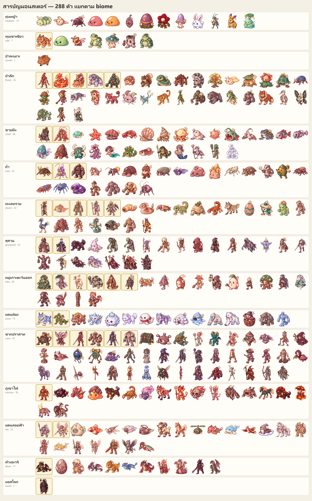

## สารบัญ

| # | Biome | ชื่อ | มอน | บอส | tier | รูปรวม |
|---|---|---|---|---|---|---|
| 1 | [meadow](#meadow) | ทุ่งหญ้า | 13 | 0 | 1–2 | [ดูรูป](sheets/01-meadow.png) |
| 2 | [vale](#vale) | หุบเขาเขียว | 6 | 1 | 1–2 | [ดูรูป](sheets/02-vale.png) |
| 3 | [woods](#woods) | ป่าละเมาะ | 1 | 0 | 1–1 | [ดูรูป](sheets/03-woods.png) |
| 4 | [forest](#forest) | ป่าลึก | 30 | 5 | 1–4 | [ดูรูป](sheets/04-forest.png) |
| 5 | [coast](#coast) | ชายฝั่ง | 26 | 2 | 1–4 | [ดูรูป](sheets/05-coast.png) |
| 6 | [cave](#cave) | ถ้ำ | 20 | 3 | 1–4 | [ดูรูป](sheets/06-cave.png) |
| 7 | [desert](#desert) | ทะเลทราย | 18 | 5 | 2–5 | [ดูรูป](sheets/07-desert.png) |
| 8 | [graveyard](#graveyard) | สุสาน | 21 | 2 | 3–5 | [ดูรูป](sheets/08-graveyard.png) |
| 9 | [isles](#isles) | หมู่เกาะตะวันออก | 14 | 6 | 3–5 | [ดูรูป](sheets/09-isles.png) |
| 10 | [snow](#snow) | แดนหิมะ | 13 | 2 | 2–5 | [ดูรูป](sheets/10-snow.png) |
| 11 | [ruins](#ruins) | ซากปราสาท | 41 | 6 | 3–5 | [ดูรูป](sheets/11-ruins.png) |
| 12 | [volcano](#volcano) | ภูเขาไฟ | 17 | 1 | 3–5 | [ดูรูป](sheets/12-volcano.png) |
| 13 | [sky](#sky) | แดนลอยฟ้า | 21 | 2 | 3–5 | [ดูรูป](sheets/13-sky.png) |
| 14 | [abyss](#abyss) | ห้วงอเวจี | 10 | 1 | 4–5 | [ดูรูป](sheets/14-abyss.png) |
| 15 | [world](#world) | บอสโลก | 0 | 1 | 5–5 | [ดูรูป](sheets/15-world.png) |

**ธาตุ:** ไร้ธาตุ (neutral) · น้ำ (water) · ดิน (earth) · ไฟ (fire) · ลม (wind) · พิษ (poison) · ศักดิ์สิทธิ์ (holy) · มืด (shadow) · โกสต์ (ghost) · อันเดด (undead)

**tier:** ★ lv1–20 · ★★ lv20–40 · ★★★ lv40–60 · ★★★★ lv60–80 · ★★★★★ lv80+

**ขนาด:** เล็ก < 50 · กลาง 50–109 · ใหญ่ ≥ 110 (heightWorld)

---

## ทุ่งหญ้า (meadow) — 13 ตัว

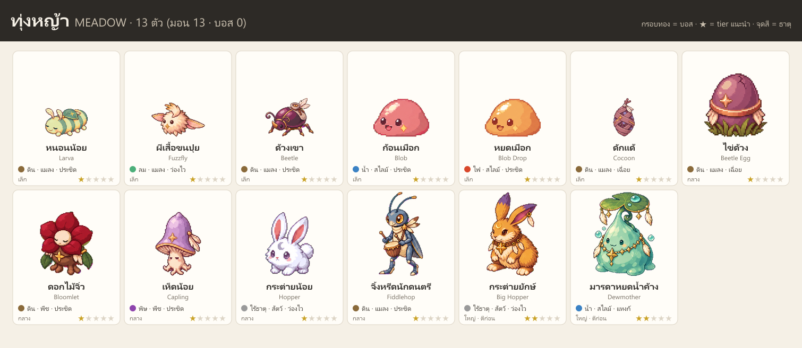

| รูป | ชื่อ | id | ประเภท | ธาตุ | บทบาท | tier | ขนาด | กลุ่ม | คำอธิบาย |
|---|---|---|---|---|---|---|---|---|---|
|  | **หนอนน้อย** Larva | `mob_meadow_larva` | แมลง | ดิน | ประชิด | ★☆☆☆☆ | เล็ก (27) | moth | หนอนผีเสื้อลายเขียวเหลืองหลับตา แบกใบไม้บนหลัง คืบช้าๆ แล้วยืดตัวชน |
| 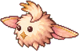 | **ผีเสื้อขนปุย** Fuzzfly | `mob_meadow_fuzzfly` | แมลง | ลม | ว่องไว | ★☆☆☆☆ | เล็ก (32) | moth | ผีเสื้อกลางคืนตัวกลมขนปุยสีครีม กระพือปีกบินแล้วพุ่งชน |
| 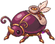 | **ด้วงเขา** Beetle | `mob_meadow_beetle` | แมลง | ดิน | ประชิด | ★☆☆☆☆ | เล็ก (36) | beetle | ด้วงตัวกลมสีม่วงมีเขางอน คลานช้าๆ แล้วพุ่งขวิดเบาๆ |
|  | **ก้อนเมือก** Blob | `mob_meadow_blob` | สไลม์ | น้ำ | ประชิด | ★☆☆☆☆ | เล็ก (36) | blob | เมือกสีชมพูตัวกลมหน้ายิ้ม เด้งดึ๋งไปมาแล้วยืดตัวชน |
|  | **หยดเมือก** Blob Drop | `mob_meadow_blob_drop` | สไลม์ | ไฟ | ประชิด | ★☆☆☆☆ | เล็ก (36) | blob | เมือกสีส้มร่างเดียวกับก้อนเมือก เด้งตัวไปมาแล้วยืดตัวชน |
|  | **ดักแด้** Cocoon | `mob_meadow_cocoon` | แมลง | ดิน | เฉื่อย | ★☆☆☆☆ | เล็ก (36) | moth | ดักแด้พันใยสีชมพูม่วงห้อยนิ่ง รอวันฟักเป็นผีเสื้อ |
|  | **ไข่ด้วง** Beetle Egg | `mob_meadow_beetle_egg` | แมลง | ดิน | เฉื่อย | ★☆☆☆☆ | กลาง (60) | beetle | ไข่ด้วงสีม่วงมีรอยร้าว วางนิ่งอยู่บนกอหญ้า |
|  | **ดอกไม้จิ๋ว** Bloomlet | `mob_meadow_bloomlet` | พืช | ดิน | ประชิด | ★☆☆☆☆ | กลาง (60) | bloomlet | ดอกไม้แดงหน้าหลับตาพริ้ม หยั่งรากกับที่ ฟาดใบไม้ใส่คนเข้าใกล้ |
|  | **เห็ดน้อย** Capling | `mob_meadow_capling` | พืช | พิษ | ประชิด | ★☆☆☆☆ | กลาง (60) | capling | เห็ดหมวกม่วงหน้าง่วงขารากเล็กๆ ปักอยู่กับที่ เอียงหมวกโขกใส่ |
|  | **กระต่ายน้อย** Hopper | `mob_meadow_hopper` | สัตว์ | ไร้ธาตุ | ว่องไว | ★☆☆☆☆ | กลาง (60) | hopper | กระต่ายขาวหูชมพูมีลายจันทร์บนหน้าผาก กระโดดไปมาแล้วพุ่งชน |
| 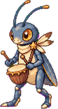 | **จิ้งหรีดนักดนตรี** Fiddlehop | `mob_meadow_fiddlehop` | แมลง | ดิน | ประชิด | ★☆☆☆☆ | กลาง (105) | fiddlehop | จิ้งหรีดยืนสองขาสะพายกลอง ตีกลองเดินไปมาแล้วจิ้มด้วยไม้ตีกลอง |
| 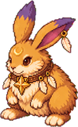 | **กระต่ายยักษ์** Big Hopper | `mob_meadow_bighopper` | สัตว์ | ไร้ธาตุ | ว่องไว · ตีก่อน | ★★☆☆☆ | ใหญ่ (130) | hopper | กระต่ายยักษ์ขนทองหูปลายม่วง มีลายจันทร์บนหน้าผาก กระโดดพุ่งชน |
|  | **มารดาหยดน้ำค้าง** Dewmother | `mob_meadow_dewmother` | สไลม์ | น้ำ | แทงก์ · ตีก่อน | ★★☆☆☆ | ใหญ่ (130) | blob | เมือกน้ำค้างตัวใหญ่สีเขียวอมฟ้า สวมใบบัวเป็นหมวก กระโดดทับศัตรู |

---

## หุบเขาเขียว (vale) — 7 ตัว

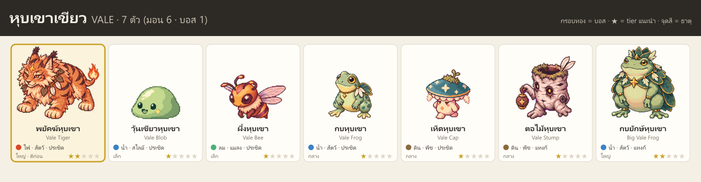

| รูป | ชื่อ | id | ประเภท | ธาตุ | บทบาท | tier | ขนาด | กลุ่ม | คำอธิบาย |
|---|---|---|---|---|---|---|---|---|---|
| 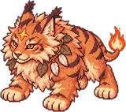 | 👑 **พยัคฆ์หุบเขา** Vale Tiger | `boss_vale_tiger` | สัตว์ | ไฟ | ประชิด · ตีก่อน | ★★☆☆☆ | ใหญ่ (170) | vale_tiger | ลูกเสือขนฟูหางเป็นเปลวไฟ สวมสร้อยใบไม้ กระโจนตะปบเหยื่อ |
|  | **วุ้นเขียวหุบเขา** Vale Blob | `mob_vale_blob` | สไลม์ | น้ำ | ประชิด | ★☆☆☆☆ | เล็ก (36) | vale_blob | ก้อนวุ้นสีเขียวยิ้มแป้น เด้งดึ๋งไปมาแล้วพุ่งชน |
| 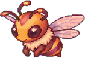 | **ผึ้งหุบเขา** Vale Bee | `mob_vale_bee` | แมลง | ลม | ประชิด | ★☆☆☆☆ | เล็ก (48) | bee | ผึ้งน้อยตาโตขนฟู บินวนไปมาแล้วพุ่งต่อยด้วยเหล็กใน |
| 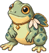 | **กบหุบเขา** Vale Frog | `mob_vale_frog` | สัตว์ | น้ำ | ประชิด | ★☆☆☆☆ | กลาง (52) | vale_frog | กบเขียวลายจุดสวมสร้อยใบไม้ กระโดดไปมาแล้วพุ่งกระแทก |
|  | **เห็ดหุบเขา** Vale Cap | `mob_vale_cap` | พืช | ดิน | ประชิด | ★☆☆☆☆ | กลาง (54) | vale_cap | เห็ดน้อยหมวกเขียวลายดาว มีต้นอ่อนงอกบนหัว เดินต้วมเตี้ยม |
| 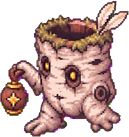 | **ตอไม้หุบเขา** Vale Stump | `mob_vale_stump` | พืช | ดิน | แทงก์ | ★☆☆☆☆ | กลาง (68) | vale_stump | ตอไม้มีชีวิตตาเรืองแสงถือโคมแดง เดินด้วยรากแล้วฟาดกิ่ง |
| 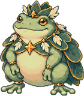 | **กบยักษ์หุบเขา** Big Vale Frog | `mob_vale_bigfrog` | สัตว์ | น้ำ | แทงก์ | ★★☆☆☆ | ใหญ่ (130) | vale_frog | คางคกยักษ์คลุมเสื้อใบไม้ นั่งนิ่งแล้วพุ่งตัวกระแทกพื้น |

---

## ป่าละเมาะ (woods) — 1 ตัว

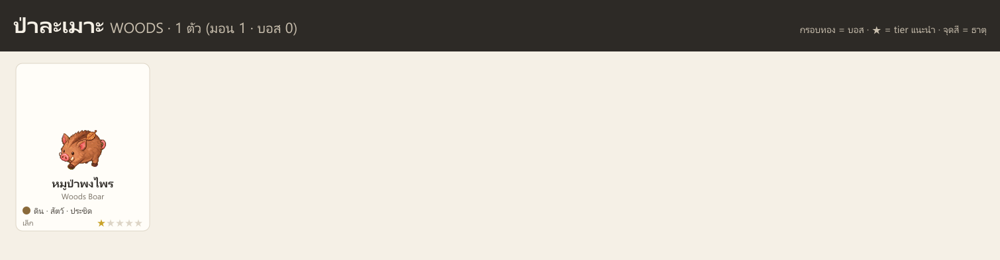

| รูป | ชื่อ | id | ประเภท | ธาตุ | บทบาท | tier | ขนาด | กลุ่ม | คำอธิบาย |
|---|---|---|---|---|---|---|---|---|---|
| 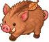 | **หมูป่าพงไพร** Woods Boar | `mob_woods_boar` | สัตว์ | ดิน | ประชิด | ★☆☆☆☆ | เล็ก (30) | boar | ลูกหมูป่าขนน้ำตาลมีใบไม้บนหลัง วิ่งพุ่งชนด้วยเขี้ยวเล็ก |

---

## ป่าลึก (forest) — 35 ตัว

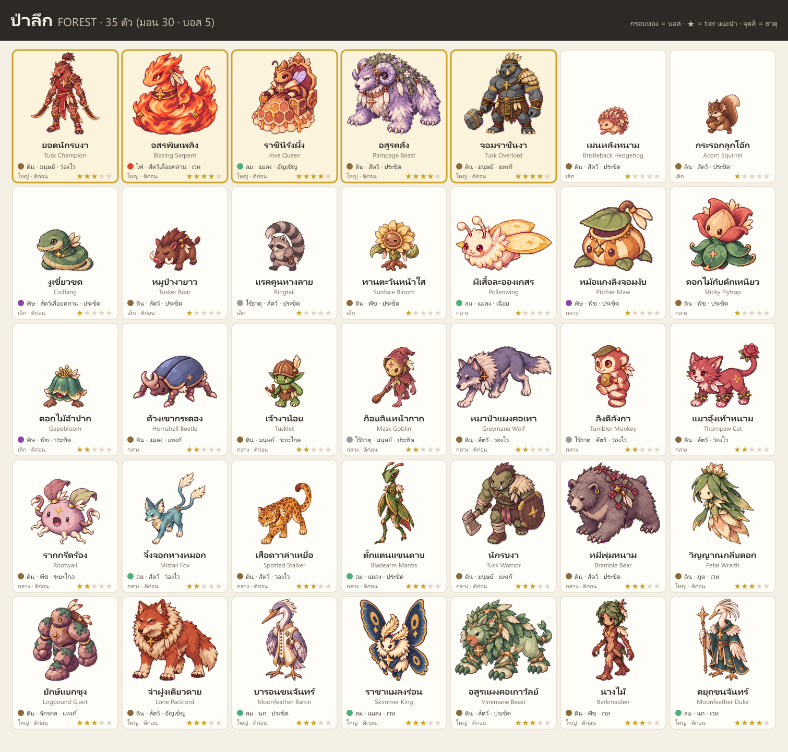

| รูป | ชื่อ | id | ประเภท | ธาตุ | บทบาท | tier | ขนาด | กลุ่ม | คำอธิบาย |
|---|---|---|---|---|---|---|---|---|---|
| 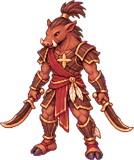 | 👑 **ยอดนักรบงา** Tusk Champion | `boss_forest_tusk_champion` | มนุษย์ | ดิน | ว่องไว · ตีก่อน | ★★★☆☆ | ใหญ่ (170) | tusk_clan | นักรบหัวหมูป่าผมมัดจุก ถือดาบโค้งสองมือ ฟันรัวอย่างว่องไว |
| 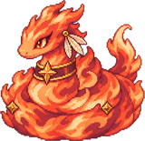 | 👑 **อสรพิษเพลิง** Blazing Serpent | `boss_forest_blazing_serpent` | สัตว์เลื้อยคลาน | ไฟ | เวท · ตีก่อน | ★★★★☆ | ใหญ่ (170) | blazing_serpent | งูยักษ์ร่างเป็นเปลวไฟขดตัว พุ่งฉกพร้อมพ่นไฟเผาป่า |
| 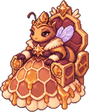 | 👑 **ราชินีรังผึ้ง** Hive Queen | `boss_forest_hive_queen` | แมลง | ลม | อัญเชิญ · ตีก่อน | ★★★★☆ | ใหญ่ (170) | hive_queen | ราชินีผึ้งสวมมงกุฎนั่งบนบัลลังก์รังผึ้งหยดน้ำผึ้ง สั่งฝูงผึ้งรุมศัตรู |
| 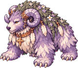 | 👑 **อสูรคลั่ง** Rampage Beast | `boss_forest_rampage_beast` | สัตว์ | ดิน | ประชิด · ตีก่อน | ★★★★☆ | ใหญ่ (170) | rampage_beast | หมีขนม่วงมีเขาแกะม้วน หลังปกคลุมใบไม้และดอกไม้ พุ่งชนอย่างบ้าคลั่ง |
| 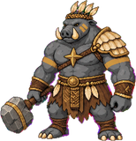 | 👑 **จอมราชันงา** Tusk Overlord | `boss_forest_tusk_overlord` | มนุษย์ | ดิน | แทงก์ · ตีก่อน | ★★★★☆ | ใหญ่ (170) | tusk_clan | หัวหน้าเผ่าหมูป่าผิวเทาร่างกำยำ สวมเกราะไหล่ ทุบค้อนหินหนักอึ้ง |
| 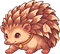 | **เม่นหลังหนาม** Bristleback Hedgehog | `mob_forest_bristleback_hedgehog` | สัตว์ | ดิน | ประชิด | ★☆☆☆☆ | เล็ก (27) | bristleback_hedgehog | เม่นตัวจิ๋วหนามสีส้มฟู เดินดุ๊กดิ๊กแล้วพุ่งกลิ้งชน |
| 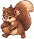 | **กระรอกลูกโอ๊ก** Acorn Squirrel | `mob_forest_acorn_squirrel` | สัตว์ | ดิน | ประชิด | ★☆☆☆☆ | เล็ก (38) | acorn_squirrel | กระรอกหางฟูสวมหมวกลูกโอ๊ก กอดลูกโอ๊กไว้แน่นแล้วพุ่งชน |
| 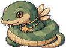 | **งูเขี้ยวขด** Coilfang | `mob_forest_coilfang` | สัตว์เลื้อยคลาน | พิษ | ประชิด · ตีก่อน | ★☆☆☆☆ | เล็ก (40) | coilfang | งูเขียวลายพรางขดตัวกลม แฝงในพุ่มไม้แล้วอ้าปากฉก |
| 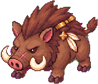 | **หมูป่างายาว** Tusker Boar | `mob_forest_tusker_boar` | สัตว์ | ดิน | ประชิด · ตีก่อน | ★☆☆☆☆ | เล็ก (42) | tusker_boar | หมูป่าขนแผงตั้งชันงาขาวโค้ง ก้มหัวพุ่งขวิดไม่ยั้ง |
|  | **แรคคูนหางลาย** Ringtail | `mob_forest_ringtail` | สัตว์ | ไร้ธาตุ | ประชิด | ★☆☆☆☆ | เล็ก (48) | ringtail | แรคคูนหางลายวงแหวนสะพายกระเป๋า ชอบขโมยของและพุ่งข่วน |
|  | **ทานตะวันหน้าใส** Sunface Bloom | `mob_forest_sunface_bloom` | พืช | ดิน | ประชิด | ★☆☆☆☆ | เล็ก (49) | sunface_bloom | ทานตะวันหลับตายิ้มหยั่งรากอยู่กับที่ ฟาดใบใส่ผู้ที่เข้าใกล้ |
| 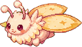 | **ผีเสื้อละอองเกสร** Pollenwing | `mob_forest_pollenwing` | แมลง | ลม | เฉื่อย | ★☆☆☆☆ | กลาง (53) | fluff_moth | มอธขนฟูสีชมพูปีกเหลือง บินโปรยละอองเกสรอย่างร่าเริง |
| 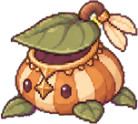 | **หม้อแกงลิงจอมงับ** Pitcher Maw | `mob_forest_pitcher_maw` | พืช | พิษ | ประชิด | ★☆☆☆☆ | กลาง (68) | carnivorous_plant | หม้อข้าวหม้อแกงลิงลายส้มมีฝาใบไม้ เดินด้วยใบแล้วงับฝาใส่ |
| 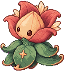 | **ดอกไม้กับดักเหนียว** Sticky Flytrap | `mob_forest_sticky_flytrap` | พืช | ดิน | ประชิด | ★☆☆☆☆ | กลาง (70) | carnivorous_plant | ดอกตูมสีแดงหน้าแป้นบนกองใบเขียว คลานต้วมเตี้ยมแล้วงับเหนียวหนึบ |
| 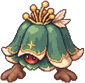 | **ดอกไม้อ้าปาก** Gapebloom | `mob_forest_gapebloom` | พืช | พิษ | ประชิด · ตีก่อน | ★★☆☆☆ | เล็ก (41) | carnivorous_plant | ดอกไม้รูประฆังสีเขียวซ่อนปากแดงไว้ข้างใน เดินด้วยรากแล้วงับเหยื่อ |
| 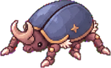 | **ด้วงเขากระดอง** Hornshell Beetle | `mob_forest_hornshell_beetle` | แมลง | ดิน | แทงก์ | ★★☆☆☆ | กลาง (50) | hornshell_beetle | ด้วงกระดองแข็งสีน้ำเงินเขาโค้ง เดินช้าแต่ขวิดแรง |
| 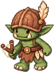 | **เจ้างาน้อย** Tusklet | `mob_forest_tusklet` | มนุษย์ | ดิน | ระยะไกล · ตีก่อน | ★★☆☆☆ | กลาง (51) | tusk_clan | ก็อบลินตัวเขียวสวมหมวกกะลา ถือหนังสติ๊กยิงก้อนหินจากระยะไกล |
| 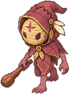 | **ก็อบลินหน้ากาก** Mask Goblin | `mob_forest_mask_goblin` | มนุษย์ | ไร้ธาตุ | ประชิด · ตีก่อน | ★★☆☆☆ | กลาง (58) | mask_goblin | ก็อบลินคลุมฮู้ดแดงสวมหน้ากากสาน ถือกระบองไม้เดินไล่ทุบ |
| 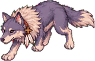 | **หมาป่าแผงคอเทา** Greymane Wolf | `mob_forest_greymane_wolf` | สัตว์ | ดิน | ว่องไว · ตีก่อน | ★★☆☆☆ | กลาง (59) | wolf | หมาป่าขนม่วงเทาแผงคอฟู ย่องเข้าหาแล้วกระโจนกัด |
| 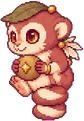 | **ลิงตีลังกา** Tumbler Monkey | `mob_forest_tumbler_monkey` | สัตว์ | ไร้ธาตุ | ว่องไว | ★★☆☆☆ | กลาง (60) | tumbler_monkey | ลิงน้อยสวมหมวกใบไม้กอดลูกไม้ไว้ เด้งตัวด้วยหางขดเป็นสปริง |
| 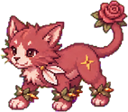 | **แมวอุ้งเท้าหนาม** Thornpaw Cat | `mob_forest_thornpaw_cat` | สัตว์ | ดิน | ว่องไว | ★★☆☆☆ | กลาง (62) | thornpaw_cat | แมวขนแดงหางปลายเป็นดอกกุหลาบ ข้อเท้าพันเถาหนาม กระโจนข่วน |
| 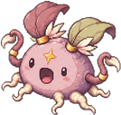 | **รากกรีดร้อง** Rootwail | `mob_forest_rootwail` | พืช | ดิน | ระยะไกล · ตีก่อน | ★★☆☆☆ | กลาง (63) | rootwail | หัวผักสีชมพูหน้าตกใจปักรากอยู่กับที่ ร้องโหยหวนแล้วเหวี่ยงรากฟาดไกล |
| 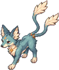 | **จิ้งจอกหางหมอก** Mistail Fox | `mob_forest_mistail_fox` | สัตว์ | ลม | ว่องไว · ตีก่อน | ★★☆☆☆ | กลาง (69) | mistail_fox | จิ้งจอกขนฟ้าหม่นสองหางปลายฟูเหมือนหมอก วิ่งไวและกระโจนงับ |
| 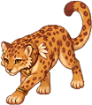 | **เสือดาวล่าเหยื่อ** Spotted Stalker | `mob_forest_spotted_stalker` | สัตว์ | ดิน | ว่องไว · ตีก่อน | ★★★☆☆ | กลาง (59) | spotted_stalker | เสือดาวลายจุดย่องต่ำในพุ่มไม้ แล้วกระโจนตะปบอย่างรวดเร็ว |
| 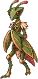 | **ตั๊กแตนแขนดาบ** Bladearm Mantis | `mob_forest_bladearm_mantis` | แมลง | ลม | ประชิด · ตีก่อน | ★★★☆☆ | กลาง (80) | bladearm_mantis | ตั๊กแตนตำข้าวยืนสองขา แขนเป็นใบมีดโค้ง เงื้อฟันอย่างแม่นยำ |
| 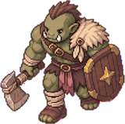 | **นักรบงา** Tusk Warrior | `mob_forest_tusk_warrior` | มนุษย์ | ดิน | แทงก์ · ตีก่อน | ★★★☆☆ | กลาง (96) | tusk_clan | นักรบออร์คผิวเขียวเขี้ยวงอก ถือขวานและโล่ไม้ ทุบอย่างหนักแน่น |
| 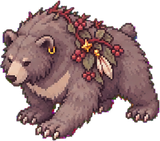 | **หมีพุ่มหนาม** Bramble Bear | `mob_forest_bramble_bear` | สัตว์ | ดิน | ประชิด · ตีก่อน | ★★★☆☆ | กลาง (109) | bramble_bear | หมีขนน้ำตาลมีเถาหนามและผลเบอร์รีพาดหลัง พุ่งตะปบอย่างดุร้าย |
| 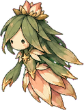 | **วิญญาณกลีบดอก** Petal Wraith | `mob_forest_petal_wraith` | ภูต | ดิน | เวท · ตีก่อน | ★★★☆☆ | ใหญ่ (115) | dryad | ภูตสาวผมใบไม้ยาว ร่างล่างเป็นกลีบดอกบัว ลอยพุ่งโปรยกลีบใส่ศัตรู |
| 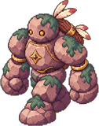 | **ยักษ์แบกซุง** Logbound Giant | `mob_forest_logbound_giant` | จักรกล | ดิน | แทงก์ · ตีก่อน | ★★★☆☆ | ใหญ่ (128) | logbound_giant | ยักษ์ก้อนหินมีตะไคร่เกาะ แบกท่อนซุงไว้บนหลัง ต่อยหมัดหนักหน่วง |
| 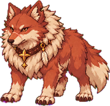 | **จ่าฝูงเดียวดาย** Lone Packlord | `mob_forest_lone_packlord` | สัตว์ | ดิน | อัญเชิญ · ตีก่อน | ★★★☆☆ | ใหญ่ (130) | wolf | หมาป่าขนแดงแผงคอหนา ยืนผงาดหอนเรียกฝูงแล้วกระโจนขย้ำ |
| 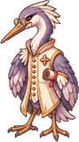 | **บารอนขนจันทร์** Moonfeather Baron | `mob_forest_moonfeather_baron` | นก | ลม | ประชิด · ตีก่อน | ★★★☆☆ | ใหญ่ (130) | moonfeather | นกกระสาขนม่วงใส่แว่นและเสื้อกั๊ก หนีบม้วนคัมภีร์ จิกด้วยจะงอยยาว |
| 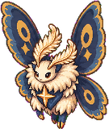 | **ราชาแมลงร่อน** Skimmer King | `mob_forest_skimmer_king` | แมลง | ลม | เวท · ตีก่อน | ★★★☆☆ | ใหญ่ (130) | fluff_moth | มอธยักษ์ขนฟูปีกน้ำเงินลายตาทอง กระพือโปรยผงพิษแล้วโฉบชน |
| 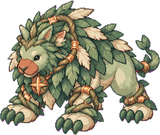 | **อสูรแผงคอเถาวัลย์** Vinemane Beast | `mob_forest_vinemane_beast` | สัตว์ | ดิน | ประชิด · ตีก่อน | ★★★☆☆ | ใหญ่ (130) | vinemane_beast | สิงโตขนเขียวแผงคอเป็นใบไม้และเถาวัลย์ พุ่งตะครุบอย่างทรงพลัง |
| 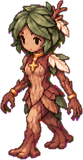 | **นางไม้** Barkmaiden | `mob_forest_barkmaiden` | พืช | ดิน | เวท · ตีก่อน | ★★★☆☆ | ใหญ่ (140) | dryad | หญิงสาวร่างเปลือกไม้ผมใบไม้สีเขียว เดินเงียบแล้วกวาดแขนร่ายมนตร์ |
| 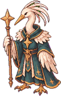 | **ดยุกขนจันทร์** Moonfeather Duke | `mob_forest_moonfeather_duke` | นก | ลม | เวท · ตีก่อน | ★★★★☆ | ใหญ่ (130) | moonfeather | นกยางขาวในเสื้อคลุมจอมเวทสีเขียวเข้ม ถือคทาดาวร่ายเวทและฟาด |

---

## ชายฝั่ง (coast) — 28 ตัว

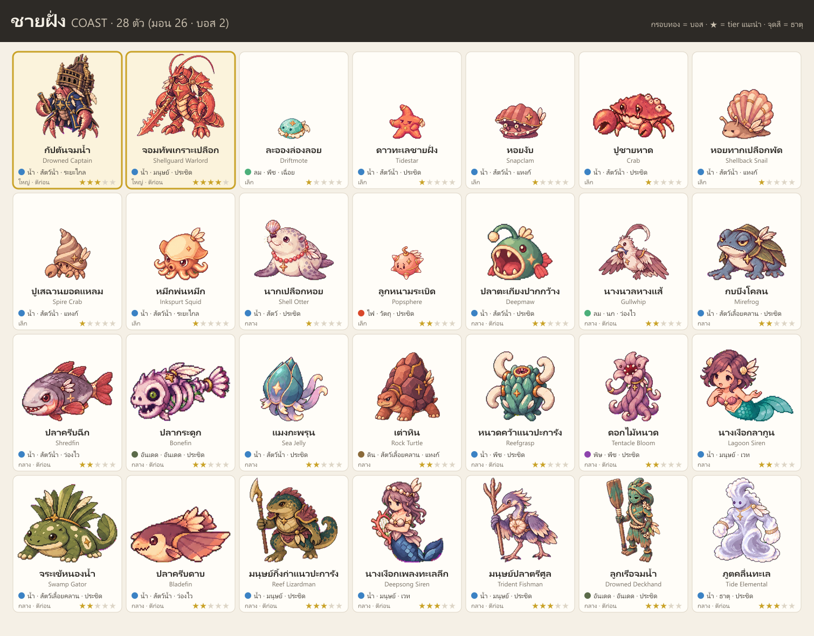

| รูป | ชื่อ | id | ประเภท | ธาตุ | บทบาท | tier | ขนาด | กลุ่ม | คำอธิบาย |
|---|---|---|---|---|---|---|---|---|---|
| 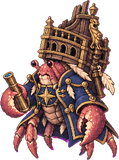 | 👑 **กัปตันจมน้ำ** Drowned Captain | `boss_coast_drowned_captain` | สัตว์น้ำ | น้ำ | ระยะไกล · ตีก่อน | ★★★☆☆ | ใหญ่ (170) | hermit_crab | ปูเสฉวนสวมเสื้อกัปตันแบกท้ายเรือใบเป็นกระดอง ถือกล้องส่องทางไกลเล็งยิง |
|  | 👑 **จอมทัพเกราะเปลือก** Shellguard Warlord | `boss_coast_shellguard_warlord` | มนุษย์ | น้ำ | ประชิด · ตีก่อน | ★★★★☆ | ใหญ่ (170) | lobster | นักรบกุ้งมังกรเกราะแดง ถือดาบหยักฟันฟาดอย่างหนักหน่วง |
|  | **ละอองล่องลอย** Driftmote | `mob_coast_driftmote` | พืช | ลม | เฉื่อย | ★☆☆☆☆ | เล็ก (19) | driftmote | เมล็ดพืชทะเลกลมสีฟ้าอมเขียว ลอยตามลมไปตามชายหาด |
|  | **ดาวทะเลชายฝั่ง** Tidestar | `mob_coast_tidestar` | สัตว์น้ำ | น้ำ | ประชิด | ★☆☆☆☆ | เล็ก (32) | starfish | ดาวทะเลสีส้มหน้าตาเบื่อโลก กลิ้งตัวพุ่งชนเบาๆ |
|  | **หอยงับ** Snapclam | `mob_coast_snapclam` | สัตว์น้ำ | น้ำ | แทงก์ | ★☆☆☆☆ | เล็ก (33) | clam | หอยกาบสีแดงมีตาโผล่ แง้มเปลือกแล้วงับเข้าใส่ |
|  | **ปูชายหาด** Crab | `mob_coast_crab` | สัตว์น้ำ | น้ำ | ประชิด | ★☆☆☆☆ | เล็ก (42) | crab | ปูแดงตัวกลมมีเพรียงเกาะหลัง เดินข้างแล้วหนีบด้วยก้ามใหญ่ |
|  | **หอยทากเปลือกพัด** Shellback Snail | `mob_coast_shellback_snail` | สัตว์น้ำ | น้ำ | แทงก์ | ★☆☆☆☆ | เล็ก (46) | snail | หอยทากแบกเปลือกหอยพัดสีชมพู คลานช้าๆ หน้าง่วงนอน |
|  | **ปูเสฉวนยอดแหลม** Spire Crab | `mob_coast_spirecrab` | สัตว์น้ำ | น้ำ | แทงก์ | ★☆☆☆☆ | เล็ก (48) | hermit_crab | ปูเสฉวนอาศัยในเปลือกหอยเกลียวยอดแหลม ยื่นก้ามหนีบศัตรู |
|  | **หมึกพ่นหมึก** Inkspurt Squid | `mob_coast_inkspurt_squid` | สัตว์น้ำ | น้ำ | ระยะไกล | ★☆☆☆☆ | เล็ก (49) | octopus | หมึกตัวน้อยสีส้มหัวกลมโต พ่นหมึกใส่ศัตรูจากปากจู๋ |
|  | **นากเปลือกหอย** Shell Otter | `mob_coast_shell_otter` | สัตว์ | น้ำ | ประชิด | ★☆☆☆☆ | กลาง (56) | seal | สัตว์ทะเลตัวกลมลายจุด ใส่สร้อยลูกปัด เลี้ยงเปลือกหอยไว้บนจมูก |
|  | **ลูกหนามระเบิด** Popsphere | `mob_coast_popsphere` | วัตถุ | ไฟ | ประชิด | ★★☆☆☆ | เล็ก (31) | sea_mine | ลูกกลมมีหนามและชนวนบนหัว ลอยไปมาแล้วพุ่งชนระเบิด |
|  | **ปลาตะเกียงปากกว้าง** Deepmaw | `mob_coast_deepmaw` | สัตว์น้ำ | น้ำ | ประชิด · ตีก่อน | ★★☆☆☆ | กลาง (52) | angler | ปลาตกเบ็ดสีเขียวมีตะเกียงล่อ อ้าปากกว้างเต็มไปด้วยฟัน |
|  | **นางนวลหางแส้** Gullwhip | `mob_coast_gullwhip` | นก | ลม | ว่องไว · ตีก่อน | ★★☆☆☆ | กลาง (52) | gull | นกนางนวลหงอนยาวเหมือนแส้ คาบปลาไว้ บินโฉบจิกศัตรู |
|  | **กบบึงโคลน** Mirefrog | `mob_coast_mirefrog` | สัตว์เลื้อยคลาน | น้ำ | ประชิด | ★★☆☆☆ | กลาง (52) | toad | คางคกสีน้ำเงินตาง่วงสวมผ้าคลุมใบไม้ กระโจนเข้าใส่ศัตรู |
|  | **ปลาครีบฉีก** Shredfin | `mob_coast_shredfin` | สัตว์น้ำ | น้ำ | ว่องไว · ตีก่อน | ★★☆☆☆ | กลาง (56) | piranha | ปลาปิรันย่าครีบแดง ฟันแหลมคม พุ่งเข้ากัดอย่างดุดัน |
|  | **ปลากระดูก** Bonefin | `mob_coast_bonefin` | อันเดด | อันเดด | ประชิด · ตีก่อน | ★★☆☆☆ | กลาง (59) | bone_fish | ปลาเหลือแต่โครงกระดูก ตาเขียวเรืองแสง ลอยมางับไม่หยุด |
|  | **แมงกะพรุน** Sea Jelly | `mob_coast_jelly` | สัตว์น้ำ | น้ำ | ประชิด | ★★☆☆☆ | กลาง (60) | jellyfish | แมงกะพรุนหัวตูมสีเขียวน้ำทะเล หนวดชมพูยาวไว้ต่อยพิษ |
|  | **เต่าหิน** Rock Turtle | `mob_coast_rock_turtle` | สัตว์เลื้อยคลาน | ดิน | แทงก์ | ★★☆☆☆ | กลาง (64) | turtle | เต่ากระดองหินก้อนใหญ่ เดินช้าแต่ทนทานมาก |
|  | **หนวดคว้าแนวปะการัง** Reefgrasp | `mob_coast_reefgrasp` | พืช | น้ำ | ประชิด · ตีก่อน | ★★☆☆☆ | กลาง (65) | tentacle_plant | กอปะการังสีเขียวมีปากด้านบน ยื่นหนวดยาวคว้าคนที่เดินผ่าน |
|  | **ดอกไม้หนวด** Tentacle Bloom | `mob_coast_tentacle_bloom` | พืช | พิษ | ประชิด · ตีก่อน | ★★☆☆☆ | กลาง (65) | tentacle_plant | ดอกไม้สีชมพูปากเต็มฟัน ลำต้นเป็นหนวดพันกัน ฟาดหนวดใส่ผู้ที่เข้าใกล้ |
|  | **นางเงือกลากูน** Lagoon Siren | `mob_coast_lagoon_siren` | มนุษย์ | น้ำ | เวท | ★★☆☆☆ | กลาง (67) | siren | นางเงือกน้อยหางเขียวมรกต ประดับเปลือกหอยบนผม ร่าเริงสดใส |
|  | **จระเข้หนองน้ำ** Swamp Gator | `mob_coast_swamp_gator` | สัตว์เลื้อยคลาน | น้ำ | ประชิด · ตีก่อน | ★★☆☆☆ | กลาง (77) | swamp_gator | สัตว์เลื้อยคลานสีเขียวมีแผงใบไม้บนหลัง อ้าปากงับเหยื่อ |
|  | **ปลาครีบดาบ** Bladefin | `mob_coast_bladefin` | สัตว์น้ำ | น้ำ | ว่องไว · ตีก่อน | ★★☆☆☆ | กลาง (82) | flying_fish | ปลาบินครีบกว้างคมกริบ กระโดดพ้นน้ำแล้วพุ่งเฉือนศัตรู |
|  | **มนุษย์กิ้งก่าแนวปะการัง** Reef Lizardman | `mob_coast_reef_lizardman` | มนุษย์ | น้ำ | ประชิด · ตีก่อน | ★★★☆☆ | กลาง (81) | lizardman | มนุษย์กิ้งก่าลายจุดสวมเกราะไหล่ ถือฉมวกแทงศัตรู |
|  | **นางเงือกเพลงทะเลลึก** Deepsong Siren | `mob_coast_deepsong_siren` | มนุษย์ | น้ำ | เวท · ตีก่อน | ★★★☆☆ | กลาง (83) | siren | นางเงือกหางน้ำเงินถือพิณปะการัง ดีดเพลงสะกดผู้ที่หลงเข้ามา |
|  | **มนุษย์ปลาตรีศูล** Trident Fishman | `mob_coast_trident_fishman` | มนุษย์ | น้ำ | ประชิด · ตีก่อน | ★★★☆☆ | กลาง (84) | heron_folk | นักรบร่างนกกระสาสวมเกราะเปลือกหอย ถือตรีศูลแทงศัตรู |
|  | **ลูกเรือจมน้ำ** Drowned Deckhand | `mob_coast_drowned_deckhand` | อันเดด | อันเดด | ประชิด · ตีก่อน | ★★★☆☆ | กลาง (90) | drowned | ลูกเรือผิวเขียวที่จมทะเล มีเพรียงเกาะตัว ถือไม้พายฟาดศัตรู |
|  | **ภูตคลื่นทะเล** Tide Elemental | `mob_coast_tide_elemental` | ธาตุ | น้ำ | ประชิด · ตีก่อน | ★★★☆☆ | กลาง (96) | tide_elemental | ภูตร่างคลื่นน้ำมีฟองที่มือและเท้า ต่อยด้วยกำปั้นน้ำหนักหน่วง |

---

## ถ้ำ (cave) — 23 ตัว

| รูป | ชื่อ | id | ประเภท | ธาตุ | บทบาท | tier | ขนาด | กลุ่ม | คำอธิบาย |
|---|---|---|---|---|---|---|---|---|---|
|  | 👑 **ด้วงเขาแห่งถ้ำ** Cave Beetle | `boss_cave_beetle` | แมลง | ดิน | แทงก์ · ตีก่อน | ★★★☆☆ | ใหญ่ (170) | beetle | ด้วงเขายักษ์กระดองลายดวงดาว พุ่งชนด้วยเขาคู่อันแข็งแกร่ง |
|  | 👑 **จักรพรรดินีฝูงแมลง** Brood Empress | `boss_cave_brood_empress` | แมลง | ดิน | อัญเชิญ · ตีก่อน | ★★★★☆ | ใหญ่ (170) | brood_queen | แมลงขายาวที่มีท้องเป็นผลึกสีม่วง ปกครองและเรียกฝูงลูกหลานมาช่วย |
|  | 👑 **ยักษ์สว่านเหล็ก** Drill Colossus | `boss_cave_drill_colossus` | จักรกล | ไฟ | แทงก์ · ตีก่อน | ★★★★☆ | ใหญ่ (200) | mine_construct | หุ่นเหล็กยักษ์แขนสว่าน อกเป็นเตาไฟลุกโชน เจาะทะลวงทุกสิ่งขวางหน้า |
|  | **หนูขุดโพรง** Burrow Rat | `mob_cave_burrow_rat` | สัตว์ | ไร้ธาตุ | ประชิด | ★☆☆☆☆ | เล็ก (23) | rat | หนูอ้วนกลมกอดชีสไว้แน่น วิ่งงับเมื่อถูกรบกวน |
|  | **มดน้ำผึ้ง** Honey Ant | `mob_cave_honeyant` | แมลง | ดิน | ประชิด | ★☆☆☆☆ | เล็ก (32) | ant | มดสีม่วงท้องป่องเก็บน้ำผึ้งสีทอง เดินหาอาหารอย่างขยันขันแข็ง |
|  | **ตุ่นถ้ำ** Cave Mole | `mob_cave_mole` | สัตว์ | ดิน | ประชิด | ★☆☆☆☆ | เล็ก (32) | mole | ตุ่นตัวกลมสวมแว่นกันฝุ่น อุ้งเท้าใหญ่ไว้ขุดดิน |
|  | **คนแคระกรวด** Pebble Gnome | `mob_cave_pebble_gnome` | มนุษย์ | ดิน | ประชิด | ★☆☆☆☆ | เล็ก (48) | gnome | คนแคระเคราขาวสวมหมวกก้อนกรวด เดินดุ๊กดิ๊กแล้วพุ่งเอาหัวชน |
|  | **มดอุโมงค์** Tunnel Ant | `mob_cave_tunnel_ant` | แมลง | ดิน | แทงก์ | ★★☆☆☆ | เล็ก (30) | ant | แมลงหลังเกราะหินหนา เดินต้วมเตี้ยมไปตามอุโมงค์ |
|  | **ค้างคาวปีกสนธยา** Duskwing Bat | `mob_cave_duskwing_bat` | แมลง | มืด | ว่องไว | ★★☆☆☆ | เล็ก (32) | duskwing | สัตว์ปีกขนฟูสีม่วง หนวดยาว บินวนกระพือปีกในความมืด |
|  | **สไลม์เหล็ก** Iron Blob | `mob_cave_ironblob` | สไลม์ | ดิน | แทงก์ | ★★☆☆☆ | เล็ก (37) | rock_slime | สไลม์ผิวโลหะสีทองแดงมีเฟืองบนหัว เด้งดึ๋งช้าๆ แต่ตัวแข็ง |
|  | **สไลม์หลังผลึก** Crystalback | `mob_cave_crystalback` | สไลม์ | ดิน | แทงก์ | ★★☆☆☆ | เล็ก (47) | rock_slime | ก้อนเยลลี่สีพีชมีผลึกอำพันงอกบนหลัง คลานช้าๆ อย่างใจเย็น |
|  | **แมงมุมถ้ำ** Cavern Spider | `mob_cave_cavern_spider` | แมลง | ดิน | ประชิด · ตีก่อน | ★★☆☆☆ | เล็ก (48) | spider | แมงมุมสีขาวซีดท้องเหลี่ยมเหมือนหิน ซุ่มตัวในเงามืดของถ้ำ |
|  | **ตัวนิ่มจมูกสว่าน** Drillshell | `mob_cave_drillshell` | สัตว์ | ดิน | แทงก์ | ★★☆☆☆ | กลาง (51) | armadillo | ตัวนิ่มเกราะปล้องมีจมูกเป็นสว่าน พุ่งเจาะเข้าใส่ศัตรู |
|  | **โจรสุนัขคำราม** Snarlhound Raider | `mob_cave_snarlhound_raider` | สัตว์ | ไร้ธาตุ | ประชิด · ตีก่อน | ★★☆☆☆ | กลาง (58) | badger_raider | โจรขนฟูสวมเสื้อกั๊ก ถือกระบองกระดูกไล่ทุบนักผจญภัย |
|  | **หัวกาต้มน้ำ** Boilerhead | `mob_cave_boilerhead` | จักรกล | ไฟ | ระยะไกล · ตีก่อน | ★★☆☆☆ | กลาง (76) | boilerhead | กาน้ำทองเหลืองเดินด้วยขาเฟือง พ่นไอน้ำร้อนจากพวยกา |
|  | **แมงมุมทอใย** Webweaver | `mob_cave_webweaver` | แมลง | ดิน | ระยะไกล · ตีก่อน | ★★★☆☆ | เล็ก (48) | spider | แมงมุมขนแดงลายใยบนหลัง ตาหลายดวง ยิงใยดักเหยื่อ |
|  | **ตะขาบร้อยขา** Hundredleg | `mob_cave_hundredleg` | แมลง | พิษ | ประชิด · ตีก่อน | ★★★☆☆ | กลาง (55) | centipede | ตะขาบยักษ์หัวเกราะแดง ขาเยอะยั้วเยี้ย ม้วนตัวพุ่งกัด |
|  | **แมงมุมชักใยพิษ** Venom Spinner | `mob_cave_venom_spinner` | แมลง | พิษ | ระยะไกล · ตีก่อน | ★★★☆☆ | กลาง (56) | spider | แมงมุมสีน้ำเงินขาลายม่วง เขี้ยวหยดพิษ พ่นพิษใส่เหยื่อ |
|  | **หนอนเจาะดินผู้เฒ่า** Elder Burrower | `mob_cave_elder_burrower` | แมลง | ดิน | ประชิด · ตีก่อน | ★★★☆☆ | กลาง (57) | burrow_worm | หนอนปล้องสีม่วงปากกลมเต็มไปด้วยฟัน พุ่งตัวออกมางับเหยื่อ |
|  | **โครงกระดูกเหมือง** Mine Skeleton | `mob_cave_mine_skeleton` | จักรกล | ดิน | ประชิด · ตีก่อน | ★★★☆☆ | กลาง (104) | mine_construct | หุ่นคนงานเหมืองหัวเป็นตะเกียง ถือพลั่วเล็กพุ่งเข้าฟาด |
|  | **ยักษ์หินย้อย** Dripstone Hulk | `mob_cave_dripstone_hulk` | ธาตุ | ดิน | แทงก์ · ตีก่อน | ★★★☆☆ | ใหญ่ (118) | golem | ยักษ์หินร่างหินงอกหินย้อย กำปั้นใหญ่ทุบพื้นสะเทือน |
|  | **กระทิงเขาวงกต** Labyrinth Bull | `mob_cave_labyrinth_bull` | สัตว์ | ดิน | ประชิด · ตีก่อน | ★★★☆☆ | ใหญ่ (123) | ram_brute | มนุษย์สัตว์ขนฟูเขาม้วน ถือค้อนหินยักษ์ทุบไม่ยั้ง |
|  | **ราชินีแมลงสีม่วง** Violet Broodqueen | `mob_cave_violet_broodqueen` | แมลง | พิษ | อัญเชิญ · ตีก่อน | ★★★☆☆ | ใหญ่ (150) | brood_queen | แมลงยักษ์ท้องป่องสีชมพูม่วง หนวดยาว คอยปกป้องรังและเรียกลูกฝูง |

---

## ทะเลทราย (desert) — 23 ตัว

| รูป | ชื่อ | id | ประเภท | ธาตุ | บทบาท | tier | ขนาด | กลุ่ม | คำอธิบาย |
|---|---|---|---|---|---|---|---|---|---|
|  | 👑 **จักรพรรดิเนินทราย** Dune Emperor | `boss_desert_dune_emperor` | มนุษย์ | มืด | เวท · ตีก่อน | ★★★★☆ | ใหญ่ (170) | jackal_cult | ฟาโรห์หัวหมาในในผ้าคลุมลายแดงทอง ถือคทาดาวฟาดและร่ายเวทใส่ศัตรู |
|  | 👑 **วาฬทรายจอมตะกละ** Sandmaw Glutton | `boss_desert_sandmaw_glutton` | สัตว์ | ดิน | แทงก์ · ตีก่อน | ★★★★☆ | ใหญ่ (170) | sandmaw | วาฬทรายตัวโตฟันซี่ใหญ่ ว่ายใต้เนินทรายแล้วโผล่มางับทุกสิ่ง |
|  | 👑 **เจ้าสุสานสุริยะ** Solar Tomb Lord | `boss_desert_solar_tomb_lord` | จักรกล | ไฟ | แทงก์ · ตีก่อน | ★★★★☆ | ใหญ่ (170) | sun_golem | โกเลมหินทรายมีวงรัศมีสุริยะหลังศีรษะ เฝ้าสุสานและต่อยหมัดหนัก |
|  | 👑 **ราชาสุสาน** Tomb King | `boss_desert_tomb_king` | อันเดด | อันเดด | เวท · ตีก่อน | ★★★★☆ | ใหญ่ (170) | linenwalker | มัมมี่สวมหน้ากากนกอีบิสสีเขียว ถือไม้เท้าตะขอฟาดและสาปผู้บุกรุก |
|  | 👑 **จอมราชันปีศาจทราย** Sandfiend Sovereign | `boss_desert_sandfiend_sovereign` | ปีศาจ | ดิน | ประชิด · ตีก่อน | ★★★★★ | ใหญ่ (200) | sandfiend | ปีศาจเกราะทรายมีปีกค้างคาวและมงกุฎหนาม กางกรงเล็บพุ่งตะปบ |
|  | **หนอนมุดทราย** Sandburrower | `mob_desert_sandburrower` | แมลง | ดิน | ประชิด · ตีก่อน | ★★☆☆☆ | เล็ก (30) | sandburrower | หนอนทรายตัวป้อมปากกลมเต็มไปด้วยฟัน มุดทรายแล้วยืดตัวงับ |
|  | **งูพิษเนินทราย** Dune Viper | `mob_desert_dune_viper` | สัตว์เลื้อยคลาน | ดิน | ประชิด · ตีก่อน | ★★☆☆☆ | เล็ก (40) | dune_viper | งูหางกระดิ่งสีทรายขดตัวรอ แล้วพุ่งฉกด้วยเขี้ยวพิษ |
|  | **แร้งทะเลทราย** Desert Vulture | `mob_desert_bird` | นก | ลม | ว่องไว · ตีก่อน | ★★☆☆☆ | กลาง (51) | desert_vulture | แร้งหัวโล้นสีชมพู บินวนเหนือผืนทรายแล้วโฉบจิกเหยื่อ |
|  | **กิ้งก่าคอระบาย** Frillneck | `mob_desert_frillneck` | สัตว์เลื้อยคลาน | ดิน | ประชิด | ★★☆☆☆ | กลาง (51) | frillneck | กิ้งก่าลายส้มเขียวมีแผงคอระบาย หางม้วน ชอบพุ่งงับเมื่อถูกรบกวน |
|  | **เต่าขี้เซา** Sandsleeper | `mob_desert_sandsleeper` | สัตว์เลื้อยคลาน | ดิน | แทงก์ | ★★☆☆☆ | กลาง (52) | desert_tortoise | เต่าทะเลทรายหลับตาพริ้ม มีกระบองเพชรงอกบนกระดอง ไม่ค่อยตื่น |
|  | **แมงป่องก้ามพิษ** Stingclaw Scorpion | `mob_desert_stingclaw_scorpion` | แมลง | พิษ | ประชิด · ตีก่อน | ★★☆☆☆ | กลาง (55) | stingclaw_scorpion | แมงป่องเปลือกแดงก้ามใหญ่ ยกหางเหล็กไนพร้อมแทงพิษ |
|  | **หมาป่าเนินทราย** Dune Wolf | `mob_desert_dune_wolf` | สัตว์ | ดิน | ว่องไว · ตีก่อน | ★★☆☆☆ | กลาง (59) | wolf | หมาป่าขนสีทรายผูกผ้าพันคอแดง วิ่งไวและกระโจนงับ |
|  | **ไข่เนินทราย** Dune Egg | `mob_desert_dune_egg` | วัตถุ | ไร้ธาตุ | เฉื่อย | ★★☆☆☆ | กลาง (60) | sandchick | ไข่ลายซิกแซกสีเขียวอมฟ้ามีขนนกงอกด้านบน วางนิ่งอยู่กลางทราย |
|  | **ลูกเจี๊ยบทราย** Sandchick | `mob_desert_sandchick` | นก | ไร้ธาตุ | ประชิด | ★★☆☆☆ | กลาง (60) | sandchick | ลูกนกขนเขียวอมฟ้าสวมหมวกสาน เดินต้วมเตี้ยมและจิกเบาๆ |
|  | **กระบองเพชรเดินได้** Spinewalker | `mob_desert_spinewalker` | พืช | ดิน | ประชิด | ★★☆☆☆ | กลาง (65) | spinewalker | กระบองเพชรหน้าบึ้งมีดอกไม้บนหัว เดินต้วมเตี้ยมและต่อยด้วยแขนหนาม |
|  | **มัมมี่เร่ร่อน** Linenwalker | `mob_desert_linenwalker` | อันเดด | อันเดด | ประชิด · ตีก่อน | ★★☆☆☆ | กลาง (84) | linenwalker | มัมมี่พันผ้าเก่าทั้งตัว ตาเดียวเรืองแสง เดินลากเท้าแล้วต่อยหมัด |
|  | **นกเท้าไว** Strider Bird | `mob_desert_strider_bird` | นก | ไร้ธาตุ | ว่องไว | ★★☆☆☆ | กลาง (90) | strider_bird | นกคอยาวขนสีน้ำเงินขายาว วิ่งเร็วข้ามเนินทรายและจิกแรง |
|  | **เต่าป้อมปราการ** Fortress Tortoise | `mob_desert_fortress_tortoise` | สัตว์เลื้อยคลาน | ดิน | แทงก์ | ★★★☆☆ | กลาง (63) | desert_tortoise | เต่ายักษ์แบกกระดองรูปป้อมปราการ เดินช้าแต่ทนทานมาก |
|  | **มัมมี่ประดับทอง** Gilded Linenwalker | `mob_desert_gilded_linenwalker` | อันเดด | อันเดด | ประชิด · ตีก่อน | ★★★☆☆ | กลาง (88) | linenwalker | มัมมี่พันผ้าคาดผ้าแดงประดับทอง เดินโซเซแล้วต่อยหมัดตรง |
|  | **นางระบำอสรพิษ** Serpent Dancer | `mob_desert_serpent_dancer` | สัตว์เลื้อยคลาน | ดิน | เวท · ตีก่อน | ★★★☆☆ | กลาง (88) | serpent_dancer | นาคีหางงูสีเขียวอมฟ้าสวมขนนก ตีกลองมือร่ายรำแล้วพุ่งเข้ารัด |
|  | **ภูตลมกรรโชก** Gust Phantom | `mob_desert_gust_phantom` | วิญญาณ | ลม | เวท · ตีก่อน | ★★★☆☆ | กลาง (103) | gust_phantom | ภูตคลุมผ้าฮู้ดขาดวิ่น ลำตัวเป็นลมหมุน ลอยพุ่งใส่พร้อมพายุทราย |
|  | **ยักษ์หินทราย** Sandstone Colossus | `mob_desert_sandstone_colossus` | จักรกล | ดิน | แทงก์ · ตีก่อน | ★★★☆☆ | กลาง (108) | sun_golem | โกเลมก้อนหินทรายมีตราสุริยะกลางอก เดินหนักและต่อยหมัดยักษ์ |
|  | **นักบวชหมาใน** Jackal Priest | `mob_desert_jackal_priest` | มนุษย์ | มืด | เวท · ตีก่อน | ★★★☆☆ | ใหญ่ (140) | jackal_cult | นักบวชหัวหมาในในชุดคลุมสีครีม ถือคทาดาว ร่ายเวทและฟาดไม้เท้า |

---

## สุสาน (graveyard) — 23 ตัว

| รูป | ชื่อ | id | ประเภท | ธาตุ | บทบาท | tier | ขนาด | กลุ่ม | คำอธิบาย |
|---|---|---|---|---|---|---|---|---|---|
|  | 👑 **สังฆราชผู้ร่วงหล่น** Fallen Prelate | `boss_graveyard_fallen_prelate` | อันเดด | อันเดด | เวท · ตีก่อน | ★★★★★ | ใหญ่ (170) | fallen_prelate | นักบวชชั้นสูงในชุดคลุมขาดวิ่นกับหมวกไมเตอร์ ยื่นมือร่ายคำสาปใส่ศัตรู |
|  | 👑 **จักรพรรดิราตรี** Night Sovereign | `boss_graveyard_night_sovereign` | อันเดด | อันเดด | เวท · ตีก่อน | ★★★★★ | ใหญ่ (200) | night_sovereign | ราชาลิชหัวกะโหลกเปลวไฟสีฟ้า สวมมงกุฎและเสื้อคลุมยาว ร่ายเวทมืด |
|  | **สุนัขเงา** Shadehound | `mob_graveyard_shadehound` | สัตว์ | มืด | ว่องไว · ตีก่อน | ★★★☆☆ | กลาง (60) | shadehound | สุนัขขนฟูสีดำม่วงตาเหลือง วิ่งเร็วแล้วกระโจนงับ |
|  | **ผีผ้าคลุม** Sheet Ghost | `mob_graveyard_sheetghost` | วิญญาณ | โกสต์ | ประชิด | ★★★☆☆ | กลาง (60) | sheetghost | ผีผ้าคลุมสีชมพูตัวกลม หน้าตาง่วงๆ ลอยไปมาแล้วพุ่งชน |
|  | **ผีแทะหลุมศพ** Gravegnaw | `mob_graveyard_gravegnaw` | อันเดด | อันเดด | ว่องไว · ตีก่อน | ★★★☆☆ | กลาง (78) | ghoul | กูลผอมแห้งหลังค่อม ย่องเร็วแล้วกระโจนข่วนด้วยกรงเล็บยาว |
|  | **ศพเดินโซเซ** Shambler | `mob_graveyard_shambler` | อันเดด | อันเดด | ประชิด · ตีก่อน | ★★★☆☆ | กลาง (78) | ghoul | ซอมบี้ผิวเขียวในผ้าขาดวิ่น เดินโซเซแล้วยื่นมือตะครุบ |
|  | **ทหารยามกระดูก** Bone Guard | `mob_graveyard_bone_guard` | อันเดด | อันเดด | ประชิด · ตีก่อน | ★★★☆☆ | กลาง (79) | bone_soldier | โครงกระดูกสวมหมวกเหล็กประดับขนนก ถือหอกยาวแทงศัตรู |
|  | **โครงกระดูกกุกกัก** Rattlebones | `mob_graveyard_rattlebones` | อันเดด | อันเดด | ประชิด · ตีก่อน | ★★★☆☆ | กลาง (79) | bone_soldier | โครงกระดูกทหารเลวถือดาบสั้น เดินกุกกักแล้วฟันลงมา |
|  | **นักธนูกระดูก** Bone Archer | `mob_graveyard_bone_archer` | อันเดด | อันเดด | ระยะไกล · ตีก่อน | ★★★☆☆ | กลาง (86) | bone_soldier | โครงกระดูกสะพายกระบอกลูกธนู ง้างคันธนูยิงจากระยะไกล |
|  | **ผู้ถูกพันธนาการ** Chainbound | `mob_graveyard_chainbound` | อันเดด | อันเดด | ประชิด · ตีก่อน | ★★★☆☆ | กลาง (93) | hooded_undead | ร่างคลุมฮู้ดแดงพันโซ่รอบตัว เดินเชื่องช้าแล้วต่อยด้วยกำปั้นพันโซ่ |
|  | **ผู้เฝ้าสุสาน** Grave Warden | `mob_graveyard_grave_warden` | อันเดด | อันเดด | ประชิด · ตีก่อน | ★★★☆☆ | กลาง (108) | hooded_undead | โครงกระดูกคลุมฮู้ดพกพวงกุญแจ เหวี่ยงตะเกียงฟาดผู้บุกรุกสุสาน |
|  | **อัศวินผู้ผิดคำสาบาน** Broken Oath | `mob_graveyard_broken_oath` | อันเดด | มืด | ประชิด · ตีก่อน | ★★★☆☆ | ใหญ่ (115) | fallen_knight | อัศวินเกราะเต็มตัวผู้ทรยศคำสาบาน ถือดาบหักฟันฟาดลงมา |
|  | **วิญญาณผ้าห่อศพ** Pale Shroud | `mob_graveyard_pale_shroud` | วิญญาณ | โกสต์ | ประชิด · ตีก่อน | ★★★☆☆ | ใหญ่ (121) | wraith | เรธคลุมผ้าห่อศพสีหม่นไร้ใบหน้า ลอยพุ่งเข้าข่วนด้วยมือผอมยาว |
|  | **หยดภูต** Phantom Drop | `mob_graveyard_phantom_drop` | วิญญาณ | โกสต์ | ว่องไว | ★★★☆☆ | ใหญ่ (130) | phantom_drop | ภูตหยดน้ำสีม่วงมีเทียนบนหัวและหัวใจเรืองแสง พุ่งตัวชนอย่างเร็ว |
|  | **แม่ทัพกระดูก** Bone Marshal | `mob_graveyard_bone_marshal` | อันเดด | อันเดด | ประชิด · ตีก่อน | ★★★★☆ | กลาง (93) | bone_soldier | โครงกระดูกแม่ทัพสวมหมวกขนนกและผ้าคลุมแดง ตะปบด้วยมือกระดูก |
|  | **อัศวินไร้หัว** Severed Knight | `mob_graveyard_severed_knight` | อันเดด | อันเดด | ประชิด · ตีก่อน | ★★★★☆ | กลาง (107) | fallen_knight | อัศวินไร้ศีรษะหิ้วหมวกเกราะไว้ข้างตัว มีควันวิญญาณลอยจากคอ ฟันดาบยาว |
|  | **ต้นไม้ตะแลงแกง** Gallows Tree | `mob_graveyard_gallows_tree` | พืช | มืด | แทงก์ · ตีก่อน | ★★★★☆ | ใหญ่ (119) | treant | ต้นไม้ตายยิ้มแสยะ แขวนกรงเหล็กบนกิ่ง คลานด้วยรากแล้วฟาดกิ่งใส่ |
|  | **อัศวินกระดูก** Bone Paladin | `mob_graveyard_bone_paladin` | อันเดด | อันเดด | แทงก์ · ตีก่อน | ★★★★☆ | ใหญ่ (121) | bone_soldier | โครงกระดูกอัศวินถือดาบยาวและโล่ใหญ่ ตั้งรับแน่นหนาก่อนฟันกลับ |
|  | **แม่ชีเพลงไว้อาลัย** Dirge Matron | `mob_graveyard_dirge_matron` | วิญญาณ | โกสต์ | เวท · ตีก่อน | ★★★★☆ | ใหญ่ (129) | ghost_maiden | วิญญาณแม่ชีชุดขาดวิ่นลอยตัว ชูเชิงเทียนสาดแสงเทียนใส่ศัตรู |
|  | **นางผีคร่ำครวญ** Wailing Lady | `mob_graveyard_wailing_lady` | วิญญาณ | โกสต์ | เวท · ตีก่อน | ★★★★☆ | ใหญ่ (129) | ghost_maiden | วิญญาณหญิงสาวผมม่วงยาวสยาย ลอยกรีดร้องโหยหวนใส่ศัตรู |
|  | **ดรูอิดมรณะ** Grim Druid | `mob_graveyard_grim_druid` | วิญญาณ | มืด | เวท · ตีก่อน | ★★★★☆ | ใหญ่ (140) | grim_druid | วิญญาณลอยตัวสวมกะโหลกกวางเขาแหลม ถือไม้เท้ากิ่งไม้ร่ายเวท |
|  | **ผู้เรียกกระดูก** Bone Caller | `mob_graveyard_bone_caller` | อันเดด | มืด | อัญเชิญ · ตีก่อน | ★★★★☆ | ใหญ่ (147) | bone_caller | นักเวทคลุมฮู้ดใบหน้ามืด ถือไม้เท้าหัวกะโหลก เรียกกระดูกลอยรอบตัว |
|  | **ภูตม่านมืด** Veilshade | `mob_graveyard_veilshade` | วิญญาณ | มืด | เวท · ตีก่อน | ★★★★☆ | ใหญ่ (150) | wraith | ร่างคลุมผ้ายาวไร้ใบหน้า มีหลายแขนยื่นออกจากชายเสื้อ ร่ายเงามืด |

---

## หมู่เกาะตะวันออก (isles) — 20 ตัว

| รูป | ชื่อ | id | ประเภท | ธาตุ | บทบาท | tier | ขนาด | กลุ่ม | คำอธิบาย |
|---|---|---|---|---|---|---|---|---|---|
|  | 👑 **มารดาแห่งพงไพร** Grove Matriarch | `boss_isles_grove_matriarch` | พืช | ดิน | อัญเชิญ · ตีก่อน | ★★★★★ | ใหญ่ (170) | grove_matriarch | นางไม้ร่างใบไม้หยั่งรากกับที่ ผมประดับผลไม้แดง ยื่นมือไม้ฟาดศัตรู |
|  | 👑 **จักรพรรดินีหยก** Jade Empress | `boss_isles_jade_empress` | มนุษย์ | ลม | เวท · ตีก่อน | ★★★★★ | ใหญ่ (170) | jade_empress | สตรีสูงศักดิ์ในชุดราชสำนักลอยตัว ถือร่มกระดาษสีหยกกวัดแกว่งโจมตี |
|  | 👑 **จิ้งจอกโคมจันทรา** Lunar Lantern Fox | `boss_isles_lunar_lantern_fox` | นก | ศักดิ์สิทธิ์ | เวท · ตีก่อน | ★★★★★ | ใหญ่ (170) | lunar_lantern_fox | นกกระเรียนขาวในชุดนักพรต ถือไม้เท้าแขวนกระดิ่ง เหวี่ยงกระดิ่งร่ายพลัง |
|  | 👑 **ยักษ์ภูผา** Mountain Ogre | `boss_isles_mountain_ogre` | ปีศาจ | ดิน | ประชิด · ตีก่อน | ★★★★★ | ใหญ่ (170) | oni | ยักษ์โอนิมีเขา ร่างกำยำ ถือกระบองไม้ยักษ์ทุบลงพื้นอย่างแรง |
|  | 👑 **จักรพรรดิงูขด** Coil Emperor | `boss_isles_coil_emperor` | สัตว์เลื้อยคลาน | น้ำ | แทงก์ · ตีก่อน | ★★★★★ | ใหญ่ (178) | coil_emperor | จระเข้ครึ่งงูสวมมงกุฎหยกและชุดคลุม ขดหางหนาแล้วพุ่งตะปบ |
|  | 👑 **ขุนศึกวิญญาณ** Spirit Warlord | `boss_isles_spirit_warlord` | อันเดด | อันเดด | ประชิด · ตีก่อน | ★★★★★ | ใหญ่ (200) | spirit_warlord | ซามูไรวิญญาณหน้าซีดในเกราะเต็มยศ ปักธงหลัง ฟันดาบคาตานะรุนแรง |
|  | **มังกรเทศกาล** Festival Dragon | `mob_isles_festival_dragon` | มังกร | ไฟ | ประชิด | ★★★☆☆ | กลาง (51) | festival_dragon | มังกรตัวน้อยในชุดเชิดสิงโตสีแดง ห้อยกระดิ่ง ก้มหัวพุ่งชน |
|  | **ร่มกระโดด** Parasol Hopper | `mob_isles_parasol_hopper` | วัตถุ | น้ำ | ว่องไว | ★★★☆☆ | กลาง (64) | tsukumogami | ร่มกระดาษตาเดียวแลบลิ้น กระโดดขาเดียวไปมาแล้วพุ่งชน |
|  | **โคมยันต์กระโดด** Talisman Hopper | `mob_isles_talisman_hopper` | วัตถุ | ศักดิ์สิทธิ์ | ประชิด | ★★★☆☆ | กลาง (83) | tsukumogami | โคมกระดาษแดงหน้ายิ้มติดแผ่นยันต์ กระโดดเตาะแตะแล้วเอียงตัวชน |
|  | **ภูตน้อยถือกระบอง** Club Imp | `mob_isles_club_imp` | ปีศาจ | ไฟ | ประชิด · ตีก่อน | ★★★☆☆ | กลาง (84) | oni | โอนิตัวน้อยผิวแดงมีเขาคู่ นุ่งกระโปรงใบไม้ เหวี่ยงกระบองหนามทุบ |
|  | **ผีถือโคม** Lantern Ghoul | `mob_isles_lantern_ghoul` | อันเดด | ไฟ | ประชิด · ตีก่อน | ★★★☆☆ | กลาง (87) | hooded_undead | ผีคลุมฮู้ดหน้าซีด ถือคันไม้แขวนโคมกระดาษ ฟาดโคมใส่ผู้หลงทาง |
|  | **ภูตโมจิ** Mochi Sprite | `mob_isles_mochi_sprite` | ภูต | ดิน | ประชิด | ★★★☆☆ | กลาง (91) | mochi_sprite | ภูตโมจิตัวกลมสีพีชมีใบไม้บนหัว ถือค้อนไม้ตำโมจิทุบเบาๆ |
|  | **ตุ๊กตากระเบื้อง** Porcelain Doll | `mob_isles_porcelain_doll` | จักรกล | ไร้ธาตุ | ประชิด · ตีก่อน | ★★★☆☆ | กลาง (96) | porcelain_doll | หุ่นเชิดห้อยเชือกถือกลองใบเล็ก ยกกลองขึ้นทุบใส่ศัตรู |
|  | **พฤกษาลูกท้อ** Peach Treant | `mob_isles_peach_treant` | พืช | ดิน | แทงก์ | ★★★☆☆ | กลาง (108) | treant | ต้นท้อเดินได้หน้ายิ้ม ยอดเต็มไปด้วยลูกท้อ กางกิ่งตบศัตรู |
|  | **หน้ากากอีกา** Crow Mask | `mob_isles_crow_mask` | นก | ลม | เวท · ตีก่อน | ★★★★☆ | กลาง (93) | crow_mask | มนุษย์อีกาสวมหน้ากากขาวแบบเท็งงุ โบกพัดกระดาษปล่อยลมคม |
|  | **สาวไว้ทุกข์** Mourning Maiden | `mob_isles_mourning_maiden` | วิญญาณ | โกสต์ | เวท · ตีก่อน | ★★★★☆ | กลาง (98) | ghost_maiden | วิญญาณหญิงในชุดเขียวผมม่วงประดับดอกไม้ ใช้พัดกลมบังหน้าแล้วโบกสาป |
|  | **นักฆ่าผ้าคลุม** Veil Assassin | `mob_isles_veil_assassin` | มนุษย์ | มืด | ว่องไว · ตีก่อน | ★★★★☆ | ใหญ่ (112) | veil_assassin | นินจาคลุมหน้าถือมีดสั้นสองมือ เคลื่อนไหวว่องไวแล้วฟันไขว้ |
|  | **ดาบพเนจร** Drifting Blade | `mob_isles_drifting_blade` | มนุษย์ | ไร้ธาตุ | ประชิด · ตีก่อน | ★★★★☆ | ใหญ่ (113) | drifting_blade | นักดาบพเนจรสวมหมวกฟางและเสื้อคลุมใบไม้ เหวี่ยงง้าวใบกว้างฟัน |
|  | **เสาโทเท็มพิทักษ์** Totem Sentinel | `mob_isles_totem_sentinel` | จักรกล | ดิน | แทงก์ · ตีก่อน | ★★★★☆ | ใหญ่ (116) | totem_sentinel | เสาไม้แกะสลักหน้าดุทาสีแดง ปักอยู่กับที่แล้วโน้มตัวโขกใส่ |
|  | **จิ้งจอกเก้าเพลิง** Ninefire Vixen | `mob_isles_ninefire_vixen` | สัตว์ | ไฟ | ว่องไว · ตีก่อน | ★★★★☆ | ใหญ่ (130) | ninefire_vixen | สัตว์ขนแดงในชุดกังฟู ห้อยโคมที่ปลายหาง ออกหมัดกังฟูรวดเร็ว |

---

## แดนหิมะ (snow) — 15 ตัว

| รูป | ชื่อ | id | ประเภท | ธาตุ | บทบาท | tier | ขนาด | กลุ่ม | คำอธิบาย |
|---|---|---|---|---|---|---|---|---|---|
|  | 👑 **จ่าฝูงเขี้ยวน้ำแข็ง** Frostfang Alpha | `boss_snow_frostfang_alpha` | สัตว์ | น้ำ | ประชิด · ตีก่อน | ★★★★☆ | ใหญ่ (170) | frost_lynx | แมวป่าลิงซ์ขนฟูสีฟ้าสวมปลอกคอทอง กระโจนตะปบเหยื่ออย่างดุดัน |
|  | 👑 **มังกรสามมงกุฎ** Tri-Crown Wyrm | `boss_snow_tri_crown_wyrm` | มังกร | ดิน | แทงก์ · ตีก่อน | ★★★★★ | ใหญ่ (173) | hydra | มังกรสามหัวเกล็ดเขียวสวมมงกุฎทุกหัว คลานเข้าขย้ำพร้อมกันสามปาก |
|  | **หมูป่าขนทอง** Goldbristle Boar | `mob_snow_goldbristle_boar` | สัตว์ | ดิน | ประชิด · ตีก่อน | ★★☆☆☆ | เล็ก (42) | boar | หมูป่าขนแผงสีทองมีงาขาว พุ่งชนอย่างแรง |
|  | **ปีศาจน้อยน้ำแข็ง** Icicle Imp | `mob_snow_icicle_imp` | ธาตุ | น้ำ | ประชิด · ตีก่อน | ★★☆☆☆ | เล็ก (44) | icicle_imp | ก้อนผลึกน้ำแข็งมีก้ามคู่หน้าตาเจ้าเล่ห์ หนีบศัตรูด้วยก้าม |
|  | **ปุยหิมะ** Snow Puff | `mob_snow_puff` | สไลม์ | น้ำ | เฉื่อย | ★★☆☆☆ | กลาง (56) | snow_puff | ก้อนหิมะกลมมีหนามน้ำแข็งและดาวบนหัว ยิ้มแป้นแล้วกลิ้งชนเบาๆ |
|  | **ลูกหมาป่าหิมะ** Frost Pup | `mob_snow_frost_pup` | สัตว์ | น้ำ | ประชิด | ★★☆☆☆ | กลาง (61) | frost_wolf | ลูกหมาป่าขนฟูสีม่วงอ่อนห้อยจี้ขนนก กระโดดงับอย่างขี้เล่น |
|  | **แมวน้ำหิมะ** Snow Seal | `mob_snow_snowseal` | สัตว์ | น้ำ | เฉื่อย | ★★☆☆☆ | กลาง (65) | snowseal | ลูกแมวน้ำขาวผูกผ้าพันคอแดง คืบไปมาแล้วพุ่งชนเบาๆ |
|  | **หมาป่าย่องน้ำแข็ง** Rime Stalker | `mob_snow_rime_stalker` | สัตว์ | น้ำ | ว่องไว · ตีก่อน | ★★★☆☆ | กลาง (53) | frost_wolf | หมาป่าสีม่วงอ่อนมีหนามผลึกตามหลัง ย่องเงียบแล้วกระโจนกัด |
|  | **อิกลูยักษ์** Snowhulk | `mob_snow_snowhulk` | วัตถุ | น้ำ | แทงก์ · ตีก่อน | ★★★☆☆ | กลาง (100) | snowhulk | บ้านอิกลูมีชีวิต ประตูเป็นปากฟันแหลม ทุบด้วยแขนก้อนหิมะ |
|  | **ภูตม่านหิมะ** Snowveil Sprite | `mob_snow_snowveil_sprite` | วิญญาณ | น้ำ | เวท · ตีก่อน | ★★★☆☆ | กลาง (104) | snowveil_sprite | ภูตผ้าคลุมน้ำแข็งหน้ามืดตาเรืองแสง ลอยพลิ้วแล้วพุ่งเข้าใส่ |
|  | **วานรน้ำแข็ง** Frost Ape | `mob_snow_frost_ape` | สัตว์ | น้ำ | ประชิด · ตีก่อน | ★★★☆☆ | กลาง (109) | frost_ape | ลิงยักษ์ขนขาวหน้าสีฟ้ามีเคราน้ำแข็ง ทุบด้วยกำปั้นหนัก |
|  | **หมีน้ำแข็ง** Frost Bear | `mob_snow_frost_bear` | สัตว์ | น้ำ | ประชิด · ตีก่อน | ★★★☆☆ | กลาง (109) | frost_bear | หมีขาวขนฟูมีผลึกน้ำแข็งบนหลัง ตะปบด้วยอุ้งเท้าใหญ่ |
|  | **แม่มดครกไม้** Mortar Witch | `mob_snow_mortar_witch` | มนุษย์ | ไร้ธาตุ | ประชิด · ตีก่อน | ★★★☆☆ | ใหญ่ (124) | mortar_witch | แม่มดชราผมขาวนั่งลอยในครกไม้ ใช้สากทุบหัวศัตรู |
|  | **แมมมอธหนังหิน** Stonehide Mammoth | `mob_snow_stonehide_mammoth` | สัตว์ | ดิน | แทงก์ | ★★★★☆ | ใหญ่ (135) | mammoth | แมมมอธหลังเป็นก้อนหินงาสีฟ้า พุ่งชนและยืนสองขากระทืบ |
|  | **ยักษ์ธารน้ำแข็ง** Glacier Titan | `mob_snow_glacier_titan` | ธาตุ | น้ำ | แทงก์ · ตีก่อน | ★★★★☆ | ใหญ่ (140) | glacier_titan | ยักษ์ผลึกน้ำแข็งหน้ายิ้มสวมมงกุฎผลึก ต่อยด้วยหมัดหนัก |

---

## ซากปราสาท (ruins) — 47 ตัว

| รูป | ชื่อ | id | ประเภท | ธาตุ | บทบาท | tier | ขนาด | กลุ่ม | คำอธิบาย |
|---|---|---|---|---|---|---|---|---|---|
|  | 👑 **ทายาทไขลาน** Clockwork Heir | `boss_ruins_clockwork_heir` | จักรกล | ไร้ธาตุ | แทงก์ · ตีก่อน | ★★★★★ | ใหญ่ (170) | clockwork | ราชาคนแคระนั่งบัลลังก์บนกาน้ำชาไขลานสี่ขา เดินกระทืบไล่ผู้บุกรุก |
|  | 👑 **เคานต์สีชาด** Crimson Count | `boss_ruins_crimson_count` | แมลง | ลม | เวท · ตีก่อน | ★★★★★ | ใหญ่ (170) | crimson | ขุนนางผีเสื้อกลางคืนในเสื้อคลุมแดง บินกระพือปีกแล้วฟาดไม้เท้า |
|  | 👑 **นางดาบสีชาด** Crimson Swordlady | `boss_ruins_crimson_swordlady` | มนุษย์ | ไฟ | ประชิด · ตีก่อน | ★★★★★ | ใหญ่ (170) | crimson | อัศวินหญิงเกราะแดงถือดาบยาว ฟันกวาดและแทงพุ่งอย่างรวดเร็ว |
|  | 👑 **ยักษ์เหล็กวิบัติ** Doom Colossus | `boss_ruins_doom_colossus` | จักรกล | ไฟ | ระยะไกล · ตีก่อน | ★★★★★ | ใหญ่ (170) | doom | หุ่นยักษ์เกราะหนามติดปืนใหญ่สองแขน ระดมยิงกระสุนหนักใส่ศัตรู |
|  | 👑 **อัศวินกระจก** Mirror Knight | `boss_ruins_mirror_knight` | มนุษย์ | มืด | ประชิด · ตีก่อน | ★★★★★ | ใหญ่ (170) | mirror | อัศวินเกราะม่วงเข้มถือดาบคู่ ฟันไขว้ต่อเนื่องอย่างดุดัน |
|  | 👑 **ยักษ์หินเงามืด** Umbral Colossus | `boss_ruins_umbral_colossus` | จักรกล | ดิน | แทงก์ · ตีก่อน | ★★★★★ | ใหญ่ (182) | umbral_colossus | ยักษ์หินไร้หัวพันโซ่ทอง ทุบพื้นด้วยกำปั้นหนักอึ้ง |
|  | **หีบปากกว้าง** Chestmaw | `mob_ruins_chestmaw` | วัตถุ | ไร้ธาตุ | ประชิด · ตีก่อน | ★★★☆☆ | เล็ก (36) | mimic | หีบสมบัติมีฟันและลิ้นยาว เดินขาสั้นแล้วอ้าปากงับ |
|  | **ลูกตาจ้องมอง** Gazer Orb | `mob_ruins_gazer_orb` | ปีศาจ | มืด | ระยะไกล · ตีก่อน | ★★★☆☆ | เล็ก (38) | gazer | ก้อนเนื้อตาโตมีปีกเล็กและก้านตาสามอัน ลอยจ้องแล้วพุ่งชน |
|  | **วิญญาณควันพิษ** Smogwraith | `mob_ruins_smogwraith` | ธาตุ | พิษ | เวท · ตีก่อน | ★★★☆☆ | เล็ก (44) | smogwraith | กลุ่มควันหม่นสวมหน้ากากกันแก๊ส ลอยพ่นหมอกพิษใส่ศัตรู |
|  | **ตุ๊กตาลูกกวาด** Gingerling | `mob_ruins_gingerling` | จักรกล | ไร้ธาตุ | ประชิด | ★★★☆☆ | กลาง (55) | toy | ตุ๊กตาลูกกวาดลายมิ้นต์ ถือคทาอมยิ้มเดินโยกเยกแล้วตีหัว |
|  | **ปีศาจน้อยเขาแกะ** Horned Imp | `mob_ruins_horned_imp` | ปีศาจ | ไฟ | ประชิด · ตีก่อน | ★★★☆☆ | กลาง (57) | imp | ปีศาจน้อยผิวเขียวหัวเขาแกะทอง ถือตะเกียงเหวี่ยงตี |
|  | **กระต่ายผ้าปะ** Patchwork Bunny | `mob_ruins_patchwork_bear` | จักรกล | ไร้ธาตุ | ประชิด · ตีก่อน | ★★★☆☆ | กลาง (60) | toy | ตุ๊กตากระต่ายผ้าเย็บปะตากระดุม ถือกรรไกรใหญ่ตัดใส่ศัตรู |
|  | **โดรนยามกลไก** Sentry Drone | `mob_ruins_sentry_drone` | จักรกล | ไร้ธาตุ | ระยะไกล · ตีก่อน | ★★★☆☆ | กลาง (62) | clockwork | โดรนทองแดงตาเลนส์เดียวมีปีกขนนกเล็ก ลอยสอดแนมแล้วพุ่งชน |
|  | **ผู้เฝ้าหลังคา** Rooftop Watcher | `mob_ruins_rooftop_watcher` | จักรกล | ดิน | ว่องไว · ตีก่อน | ★★★☆☆ | กลาง (67) | gargoyle | การ์กอยล์นกฮูกหินเกาะบนแท่น กางปีกแล้วโฉบลงจิก |
|  | **หุ่นไล่กาหัวตะเกียง** Lanternhead | `mob_ruins_lanternhead` | วิญญาณ | โกสต์ | ประชิด · ตีก่อน | ★★★☆☆ | กลาง (82) | lanternhead | หุ่นไล่กาหัวกรงตะเกียงมีไฟวิญญาณสีฟ้า ฟาดด้วยคราดเหล็ก |
|  | **แม่มดคำสาป** Hexwitch | `mob_ruins_hexwitch` | มนุษย์ | มืด | เวท · ตีก่อน | ★★★☆☆ | กลาง (88) | hexwitch | แม่มดน้อยหมวกปลายงอ ลอยตัวแล้วชี้คทากิ่งไม้ร่ายคำสาป |
|  | **สาวใช้ไขลาน** Clockwork Maid | `mob_ruins_clockwork_maid` | จักรกล | ไร้ธาตุ | ว่องไว · ตีก่อน | ★★★☆☆ | กลาง (92) | clockwork | ตุ๊กตาบัลเลต์ไขลานบนแท่นกล่องดนตรี หมุนตัวเตะและฟาดแขนใส่ศัตรู |
|  | **ปีศาจม่านฝัน** Dreamveil Fiend | `mob_ruins_dreamveil_fiend` | ปีศาจ | มืด | ว่องไว · ตีก่อน | ★★★☆☆ | กลาง (99) | dreamveil | ปีศาจน้อยเขาโค้งคลุมผ้าสีชมพู กางปีกค้างคาวโฉบลงข่วน |
|  | **กรอบรูปผีสิง** Haunted Frame | `mob_ruins_haunted_frame` | วัตถุ | โกสต์ | เวท · ตีก่อน | ★★★☆☆ | กลาง (106) | haunted_frame | กรอบรูปวงรีภาพปราสาทยามค่ำ มีดวงตาจ้องออกมา ลอยพุ่งชน |
|  | **นาฬิกาปลุกเดินได้** Bellclock | `mob_ruins_bellclock` | จักรกล | ไร้ธาตุ | ประชิด · ตีก่อน | ★★★☆☆ | ใหญ่ (116) | clockwork | นาฬิกาปลุกทองเหลืองมีปีกขนนก เดินขาเหล็กแล้วตะปบด้วยมือ |
|  | **สไลม์เขา** Hornblob | `mob_ruins_hornblob` | สไลม์ | น้ำ | แทงก์ | ★★★☆☆ | ใหญ่ (130) | hornblob | สไลม์ม่วงมีเขาสวมหมวกโจรสลัด หางห้อยกระดิ่ง กระโจนทับศัตรู |
|  | **ผู้พิทักษ์เหล็ก** Iron Sentinel | `mob_ruins_iron_sentinel` | จักรกล | ไร้ธาตุ | ระยะไกล · ตีก่อน | ★★★★☆ | กลาง (83) | sentinel | หุ่นเกราะเหล็กแขนเป็นปืนใหญ่ ยืนเล็งยิงจากระยะไกล |
|  | **นางงูจ้องศิลา** Stonegaze | `mob_ruins_stonegaze` | ปีศาจ | ดิน | เวท · ตีก่อน | ★★★★☆ | กลาง (94) | gorgon | นางงูผมเป็นงูพันเกลียว ชายกระโปรงกลายเป็นหิน จ้องสาปให้ศัตรูแข็งทื่อ |
|  | **นักฆ่าเงาสะท้อน** Echo Assassin | `mob_ruins_echo_assassin` | วิญญาณ | โกสต์ | ว่องไว · ตีก่อน | ★★★★☆ | กลาง (100) | echo | ร่างจำลองนักฆ่าฮู้ดม่วงไร้หน้า ถือมีดโค้งคู่จู่โจมฉับไว |
|  | **อัศวินเงาสะท้อน** Echo Knight | `mob_ruins_echo_knight` | วิญญาณ | โกสต์ | ประชิด · ตีก่อน | ★★★★☆ | กลาง (100) | echo | ร่างจำลองอัศวินเกราะม่วงประดับขนนก ยกดาบยาวฟันจากเหนือหัว |
|  | **จอมเวทเงาสะท้อน** Echo Mage | `mob_ruins_echo_mage` | วิญญาณ | โกสต์ | เวท · ตีก่อน | ★★★★☆ | กลาง (100) | echo | ร่างจำลองนักเวทคลุมฮู้ดไร้หน้า ชูคทาอัญมณีร่ายเวทใส่ศัตรู |
|  | **นักบวชหญิงเงาสะท้อน** Echo Priestess | `mob_ruins_echo_priestess` | วิญญาณ | โกสต์ | เวท · ตีก่อน | ★★★★☆ | กลาง (100) | echo | ร่างจำลองนักบวชหญิงคลุมผ้าคลุมหัว ฟาดคทาหนามและคอยหนุนพวกพ้อง |
|  | **หอรบเดินได้** Siege Walker | `mob_ruins_siege_walker` | จักรกล | ดิน | แทงก์ · ตีก่อน | ★★★★☆ | กลาง (101) | siege_walker | หอคอยปราสาทติดขากล ยื่นท่อนซุงกระทุ้งใส่ศัตรู |
|  | **โครงกระดูกปืนคาบศิลา** Musket Revenant | `mob_ruins_musket_revenant` | อันเดด | อันเดด | ระยะไกล · ตีก่อน | ★★★★☆ | กลาง (102) | revenant | โครงกระดูกโจรสลัดสวมหมวกสามเหลี่ยม ใช้ปืนคาบศิลาทั้งยิงและฟาด |
|  | **เกราะกลวง** Hollow Armour | `mob_ruins_hollow_armour` | อันเดด | มืด | ประชิด · ตีก่อน | ★★★★☆ | กลาง (104) | hollow_armour | ชุดเกราะว่างเปล่าเดินได้เอง ไร้อาวุธ ต่อยหมัดหนักใส่ศัตรู |
|  | **จักรกลวิบัติ** Doom Engine | `mob_ruins_doom_engine` | จักรกล | ไร้ธาตุ | ประชิด · ตีก่อน | ★★★★☆ | ใหญ่ (112) | doom | หุ่นกลตาเดียวขับเคลื่อนด้วยตีนตะขาบ ยืดแขนคีมหนีบศัตรู |
|  | **แวมไพร์กำมะหยี่** Velvet Vampire | `mob_ruins_velvet_vampire` | อันเดด | มืด | ว่องไว · ตีก่อน | ★★★★☆ | ใหญ่ (123) | vampire | สาวแวมไพร์ผมแดงกระโปรงกำมะหยี่ กางปีกค้างคาวโฉบลงกัดข่วน |
|  | **อาชาราตรี** Night Steed | `mob_ruins_night_steed` | สัตว์ | มืด | ว่องไว · ตีก่อน | ★★★★☆ | ใหญ่ (126) | night_steed | ม้าดำแผงคอม่วงฟูสวมปลอกคอทอง ห้อตะบึงพุ่งชน |
|  | **ผู้พิทักษ์ดาบศิลา** Blade Sentinel | `mob_ruins_blade_sentinel` | จักรกล | ดิน | ประชิด · ตีก่อน | ★★★★☆ | ใหญ่ (130) | sentinel | รูปปั้นอัศวินหินมีเถาวัลย์พัน ยกดาบใหญ่ฟันจากบนลงล่าง |
|  | **ดาบต้องสาป** Cursed Edge | `mob_ruins_cursed_edge` | วัตถุ | มืด | ประชิด · ตีก่อน | ★★★★☆ | ใหญ่ (130) | haunted_weapon | ดาบและโล่ต้องสาปลอยได้เองห้อยขนนก พุ่งแทงใส่ผู้บุกรุก |
|  | **ขวานเพชฌฆาต** Headsman's Blade | `mob_ruins_headsman_s_blade` | วัตถุ | มืด | ประชิด · ตีก่อน | ★★★★☆ | ใหญ่ (130) | haunted_weapon | ขวานเพชฌฆาตลอยได้พันผ้าแดงขาดวิ่น ฟาดฟันลงอย่างแรง |
|  | **โจรกรงเล็บเหล็ก** Iron Marauder | `mob_ruins_iron_marauder` | มนุษย์ | ไร้ธาตุ | ประชิด · ตีก่อน | ★★★★☆ | ใหญ่ (130) | iron_marauder | โจรร่างหนาคลุมฮู้ดสวมหน้ากากเหล็ก ใช้กรงเล็บโลหะข่วนกระหน่ำ |
|  | **แฝดกระจก** Mirror Twin | `mob_ruins_mirror_twin` | จักรกล | ไร้ธาตุ | ว่องไว · ตีก่อน | ★★★★☆ | ใหญ่ (130) | mirror | ตุ๊กตากระเบื้องสวมมงกุฎกระจก ชกและเตะว่องไวราวเงาสะท้อน |
|  | **เงาโศกา** Sorrow Shade | `mob_ruins_sorrow_shade` | วิญญาณ | น้ำ | เวท · ตีก่อน | ★★★★☆ | ใหญ่ (130) | shade | วิญญาณผมฟ้าตาเศร้ามีเมฆฝนลอยเหนือหัว สะบัดแขนเสื้อยาวตบ |
|  | **ราชันฝูงแมลง** Swarm Tyrant | `mob_ruins_swarm_tyrant` | แมลง | พิษ | อัญเชิญ · ตีก่อน | ★★★★☆ | ใหญ่ (130) | swarm_tyrant | แมลงยักษ์เกราะเขียวหลังเต็มไปด้วยไข่ บินบัญชาฝูงลูกแมลงเข้าโจมตี |
|  | **ดาบหนามกุหลาบ** Thornblade | `mob_ruins_thornblade` | วัตถุ | ดิน | ประชิด · ตีก่อน | ★★★★☆ | ใหญ่ (130) | haunted_weapon | ดาบยาวลอยได้พันเถากุหลาบหนาม พุ่งแทงเป็นเส้นตรง |
|  | **เงาหวาดผวา** Dread Shade | `mob_ruins_dread_shade` | วิญญาณ | โกสต์ | ประชิด · ตีก่อน | ★★★★☆ | ใหญ่ (131) | shade | วิญญาณสวมฮู้ดหน้ากากจะงอยปาก ถือตะเกียงหัวใจ ตะครุบด้วยกรงเล็บยาว |
|  | **อัศวินสีชาด** Crimson Knight | `mob_ruins_crimson_knight` | มนุษย์ | ไฟ | ประชิด · ตีก่อน | ★★★★☆ | ใหญ่ (140) | crimson | อัศวินเกราะแดงร่างล่ำประดับขนนก เหวี่ยงดาบฟันหนักหน่วง |
|  | **ตัวตลกยิ้มแสยะ** Grinning Jester | `mob_ruins_grinning_jester` | จักรกล | ไร้ธาตุ | ประชิด · ตีก่อน | ★★★★☆ | ใหญ่ (140) | toy | หุ่นตัวตลกหน้ากากยิ้มขาไม้ยาว หมุนจานบนไม้แล้วฟาดกวาด |
|  | **เงาเคียดแค้น** Hatred Shade | `mob_ruins_hatred_shade` | วิญญาณ | ไฟ | ประชิด · ตีก่อน | ★★★★☆ | ใหญ่ (143) | shade | วิญญาณคลุมฮู้ดแดงตาเรืองแสง เหวี่ยงเคียวใหญ่ฟันกวาด |
|  | **ผู้พิทักษ์ธนูศิลา** Bow Sentinel | `mob_ruins_bow_sentinel` | จักรกล | ดิน | ระยะไกล · ตีก่อน | ★★★★☆ | ใหญ่ (150) | sentinel | รูปปั้นนักธนูหินคลุมเถาวัลย์ ง้างคันธนูยิงจากระยะไกล |
|  | **เงาสิ้นหวัง** Despair Shade | `mob_ruins_despair_shade` | วิญญาณ | โกสต์ | เวท · ตีก่อน | ★★★★☆ | ใหญ่ (150) | shade | ผ้าคลุมว่างเปล่าลอยได้ หน้ากากเหล็กแหลม โบกแขนเสื้อกว้างเข้าหาศัตรู |

---

## ภูเขาไฟ (volcano) — 18 ตัว

| รูป | ชื่อ | id | ประเภท | ธาตุ | บทบาท | tier | ขนาด | กลุ่ม | คำอธิบาย |
|---|---|---|---|---|---|---|---|---|---|
|  | 👑 **จักรพรรดิเพลิงนรก** Inferno Sovereign | `boss_volcano_inferno_sovereign` | มนุษย์ | ไฟ | ประชิด · ตีก่อน | ★★★★★ | ใหญ่ (170) | inferno_sovereign | มนุษย์นกขนแดงเพลิงสวมมงกุฎ พันโซ่ที่ข้อมือ ต่อยหมัดหนักใส่ศัตรู |
|  | **หินแก้วภูเขาไฟ** Glasscrag | `mob_volcano_glasscrag` | ธาตุ | ดิน | แทงก์ · ตีก่อน | ★★★☆☆ | เล็ก (35) | glasscrag | ก้อนหินออบซิเดียนเหลี่ยมคมมีดวงตาเล็ก กลิ้งพุ่งกระแทก |
|  | **ภูตกำปั้นไฟ** Flamefist | `mob_volcano_flamefist` | ปีศาจ | ไฟ | ประชิด · ตีก่อน | ★★★☆☆ | เล็ก (47) | flamefist | ภูตตัวจิ๋วเขาเปลวไฟมีกำปั้นลุกโชน บินเข้าต่อยรัว |
|  | **เมือกแมกมา** Magma Blob | `mob_volcano_magma_blob` | สไลม์ | ไฟ | เฉื่อย | ★★★☆☆ | เล็ก (48) | magma_blob | ก้อนเมือกลาวาสีส้มมีหินหลอมบนหัว คืบไหลแล้วพุ่งชน |
|  | **ลูกหมาถ่านไฟ** Cinderpup | `mob_volcano_cinderpup` | สัตว์ | ไฟ | ประชิด | ★★★☆☆ | กลาง (52) | cinderpup | ลูกสุนัขขนน้ำตาลท้องเรืองแสงเหมือนถ่านไฟ กระโดดงับอย่างขี้เล่น |
|  | **แมงป่องลาวา** Lava Scorpion | `mob_volcano_lava_scorpion` | แมลง | ไฟ | ประชิด · ตีก่อน | ★★★☆☆ | กลาง (55) | lava_scorpion | แมงป่องเปลือกหินมีรอยแตกลาวาเรืองแสง หนีบและต่อยด้วยหาง |
|  | **ภูตดวงไฟ** Emberwisp | `mob_volcano_emberwisp` | วิญญาณ | ไฟ | เวท · ตีก่อน | ★★★☆☆ | กลาง (60) | emberwisp | ภูตไฟร่างม่วงมีเปลวไฟชมพูลุกบนหัว ลอยพุ่งเผาศัตรู |
|  | **สุนัขถ่านเพลิง** Ember Hound | `mob_volcano_ember_hound` | สัตว์ | ไฟ | ประชิด · ตีก่อน | ★★★☆☆ | กลาง (66) | ember_hound | หมาป่าขนแดงส้มแผงคอดั่งเปลวไฟ วิ่งกระโจนกัด |
|  | **ปีศาจน้อยจุดไฟ** Kindle Imp | `mob_volcano_kindle_imp` | ปีศาจ | ไฟ | ประชิด · ตีก่อน | ★★★☆☆ | กลาง (79) | fire_imp | ปีศาจน้อยผิวแดงมีเขาและหางเปลวไฟ ถือสามง่ามแทง |
|  | **กะโหลกถ่านเพลิง** Cinder Skull | `mob_volcano_cinder_skull` | อันเดด | ไฟ | ว่องไว · ตีก่อน | ★★★☆☆ | กลาง (82) | cinder_skull | กะโหลกลุกเป็นไฟคาดผ้าประดับขนนก ลอยพุ่งชนศัตรู |
|  | **ปีศาจกองไฟ** Pyre Fiend | `mob_volcano_pyre_fiend` | ปีศาจ | ไฟ | เวท · ตีก่อน | ★★★★☆ | กลาง (93) | fire_imp | ปีศาจน้อยเขาโค้งขนเป็นเปลวไฟ ถือคบเพลิงฟาดและพ่นไฟ |
|  | **ยักษ์หินหลอมเหลว** Magma Hulk | `mob_volcano_magma_hulk` | จักรกล | ไฟ | แทงก์ · ตีก่อน | ★★★★☆ | กลาง (102) | magma_hulk | ยักษ์หินลาวามีปล่องควันบนหัว ลอยตัวแล้วต่อยด้วยหมัดหิน |
|  | **จักรกลเตาหลอม** Inferno Engine | `mob_volcano_inferno_engine` | จักรกล | ไฟ | แทงก์ · ตีก่อน | ★★★★☆ | ใหญ่ (122) | inferno_engine | หุ่นเตาหลอมหกขามีปล่องควันคู่ เดินคลานแล้วโถมชน |
|  | **อาชาเพลิงนรก** Hellfire Steed | `mob_volcano_hellfire_steed` | สัตว์ | ไฟ | ว่องไว · ตีก่อน | ★★★★☆ | ใหญ่ (126) | hellfire_steed | ม้าดำแผงคอและกีบลุกเป็นไฟ ควบพุ่งชนอย่างรวดเร็ว |
|  | **กิ้งก่าหงอนเพลิง** Flamecrest Lizard | `mob_volcano_flamecrest_lizard` | สัตว์เลื้อยคลาน | ไฟ | แทงก์ · ตีก่อน | ★★★★☆ | ใหญ่ (130) | flamecrest_lizard | กิ้งก่าหนังลาวาแผงคอแดงกางกว้าง พุ่งงับและยืนขู่ |
|  | **นางระบำเพลิง** Pyre Dancer | `mob_volcano_pyre_dancer` | วิญญาณ | ไฟ | เวท · ตีก่อน | ★★★★☆ | ใหญ่ (130) | pyre_dancer | ภูตเพลิงในกระโปรงเปลวไฟถือร่มไฟ หมุนร่ายรำเผาศัตรู |
|  | **ล่อหัวเพลิง** Ashen Mule | `mob_volcano_ashen_mule` | ปีศาจ | ไฟ | ประชิด · ตีก่อน | ★★★★☆ | ใหญ่ (132) | ashen_mule | ล่อไร้หัวมีเปลวไฟลุกแทนศีรษะ ห้อยเครื่องประดับขนนก วิ่งพุ่งชน |
|  | **อสูรสามเศียร** Threefold Beast | `mob_volcano_threefold_beast` | สัตว์ | ไฟ | ประชิด · ตีก่อน | ★★★★★ | ใหญ่ (140) | chimera | ไคมีราร่างสิงโตมีหัวแพะบนหลังและหางเป็นงู กระโจนขย้ำ |

---

## แดนลอยฟ้า (sky) — 23 ตัว

| รูป | ชื่อ | id | ประเภท | ธาตุ | บทบาท | tier | ขนาด | กลุ่ม | คำอธิบาย |
|---|---|---|---|---|---|---|---|---|---|
|  | 👑 **อัศวินวายุ** Gale Knight | `boss_sky_gale_knight` | มนุษย์ | ลม | ประชิด · ตีก่อน | ★★★★★ | ใหญ่ (170) | winged_lancer | อัศวินเกราะหนักประดับปีกขนนก ถือหอกยาวพุ่งแทงด้วยแรงลม |
|  | 👑 **ผู้ตัดสินแห่งนภา** Winged Arbiter | `boss_sky_winged_arbiter` | มนุษย์ | ศักดิ์สิทธิ์ | ประชิด · ตีก่อน | ★★★★★ | ใหญ่ (170) | arbiter | สิงห์มีปีกสวมเกราะทอง ถือดาบและตาชั่งแห่งการพิพากษา |
|  | **ก้อนปุยกรวด** Pebble Puff | `mob_sky_pebble_puff` | สไลม์ | ดิน | เฉื่อย | ★★★☆☆ | เล็ก (47) | pebble_puff | ก้อนขนปุยสีครีมมีปีกเล็กๆ เดินต้วมเตี้ยมแล้วกลิ้งชน |
|  | **นกปากใหญ่** Bigbeak | `mob_sky_bigbeak` | นก | ลม | ประชิด | ★★★☆☆ | เล็ก (49) | bigbeak | นกเงือกตัวกลมสีแดง ปากโตลายทาง บินโฉบจิกเบาๆ |
|  | **แมลงปอหอกเข็ม** Needlewing Lancer | `mob_sky_needlewing_lancer` | แมลง | ลม | ว่องไว · ตีก่อน | ★★★☆☆ | กลาง (50) | needlewing | แมลงปีกใสหางเป็นเข็มแหลม พุ่งแทงด้วยปลายหาง |
|  | **เมล็ดปุยลม** Puffseed | `mob_sky_puffseed` | พืช | ลม | ประชิด | ★★★☆☆ | กลาง (60) | puffseed | เมล็ดพันธุ์ปุยขนนกหน้าบึ้ง ลอยตามลมแล้วพุ่งจิกด้วยปลายเมล็ด |
|  | **เทวทูตจอมปลอม** False Seraph | `mob_sky_false_seraph` | วิญญาณ | มืด | ว่องไว · ตีก่อน | ★★★☆☆ | กลาง (74) | false_seraph | เทวดาตัวจิ๋วคลุมฮู้ดมีวงแหวนบนหัว ยิ้มเจ้าเล่ห์แล้วพุ่งโฉบใส่ |
|  | **แพะผา** Crag Goat | `mob_sky_crag_goat` | สัตว์ | ดิน | ประชิด | ★★★☆☆ | กลาง (86) | crag_goat | แพะเขาวงขนฟูสีครีมห้อยขนนก พุ่งชนด้วยเขาโค้ง |
|  | **หมาป่าวายุ** Galehound | `mob_sky_galehound` | สัตว์ | ลม | ว่องไว · ตีก่อน | ★★★☆☆ | กลาง (88) | gale_wolf | สุนัขป่าขนแดงหางพุ่มดั่งขนนก มีผ้าพันขา วิ่งกระโจนกัด |
|  | **หุ่นใบพัด** Spinrotor | `mob_sky_spinrotor` | จักรกล | ลม | ประชิด · ตีก่อน | ★★★☆☆ | กลาง (90) | spinrotor | หุ่นกลมใส่แว่นกลไกมีใบพัดบนหัว บินหมุนแล้วพุ่งชน |
|  | **ลูกมังกรน้อย** Wyrmkit | `mob_sky_wyrmkit` | มังกร | ไฟ | ประชิด | ★★★☆☆ | กลาง (94) | wyrmkit | ลูกมังกรสีแดงตัวป้อมปีกเขียว บินเล่นแล้วพุ่งงับ |
|  | **วาฬรัศมี** Haloblob | `mob_sky_haloblob` | สัตว์น้ำ | ลม | แทงก์ | ★★★☆☆ | ใหญ่ (130) | sky_whale | วาฬสีฟ้าตัวกลมครีบเป็นปีกขนนก ว่ายลอยกลางฟ้าอย่างสบายใจ |
|  | **เหยี่ยววายุ** Gale Hawk | `mob_sky_gale_hawk` | นก | ลม | ว่องไว · ตีก่อน | ★★★★☆ | กลาง (103) | gale_hawk | เหยี่ยวขนแดงปีกกว้าง โฉบลงมาจิกด้วยกรงเล็บแหลม |
|  | **ฤๅษีเมฆา** Cloud Sage | `mob_sky_cloudsage` | มนุษย์ | ลม | เวท | ★★★★☆ | ใหญ่ (121) | cloudsage | ชายชราเคราขาวยาวในหมวกแหลม นั่งลอยบนก้อนเมฆแล้วร่ายเวทลม |
|  | **เขี้ยวพายุ** Gustfang | `mob_sky_gustfang` | สัตว์ | ลม | ประชิด · ตีก่อน | ★★★★☆ | ใหญ่ (130) | gale_wolf | หมาป่าขาวขนยาวประดับขนนก กระโจนไกลกัดอย่างรวดเร็ว |
|  | **ผู้พิทักษ์ปราการ** Haven Warden | `mob_sky_haven_warden` | จักรกล | ศักดิ์สิทธิ์ | แทงก์ · ตีก่อน | ★★★★☆ | ใหญ่ (130) | warden | รูปปั้นอัศวินมีปีกถือโล่กลมใหญ่ ตั้งรับแล้วกระแทกด้วยโล่ |
|  | **ผู้พิทักษ์เมตตา** Mercy Warden | `mob_sky_mercy_warden` | จักรกล | ศักดิ์สิทธิ์ | เวท · ตีก่อน | ★★★★☆ | ใหญ่ (130) | warden | ร่างหุ่นไร้หน้ามีปีกถือตะเกียง เหวี่ยงแสงตะเกียงใส่ศัตรู |
|  | **วาฬเทพทอง** Seraph Blob | `mob_sky_seraph_blob` | สัตว์น้ำ | ศักดิ์สิทธิ์ | แทงก์ | ★★★★☆ | ใหญ่ (130) | sky_whale | วาฬสีทองมีปีกหลายคู่ประดับดาว ลอยกลางเวหาอย่างสง่างาม |
|  | **นางทวนสวรรค์** Spear Maiden | `mob_sky_spear_maiden` | มนุษย์ | ลม | ประชิด · ตีก่อน | ★★★★☆ | ใหญ่ (130) | winged_lancer | นักรบหญิงมีปีกสวมหมวกเกราะ ถือหอกยาวแทงกวาดศัตรู |
|  | **ผู้พิทักษ์เฝ้ายาม** Vigil Warden | `mob_sky_vigil_warden` | วิญญาณ | ศักดิ์สิทธิ์ | เวท · ตีก่อน | ★★★★☆ | ใหญ่ (130) | warden | ผู้พิทักษ์คลุมฮู้ดลอยตัว ถือคทาดวงตาเฝ้ามองและฟาดผู้บุกรุก |
|  | **ผู้พิทักษ์โทสะ** Wrath Warden | `mob_sky_wrath_warden` | มนุษย์ | ไฟ | ประชิด · ตีก่อน | ★★★★☆ | ใหญ่ (130) | warden | อัศวินมีปีกเกราะทองแดง ถือดาบเพลิงฟันอย่างดุเดือด |
|  | **กริฟฟินพายุ** Stormtalon | `mob_sky_stormtalon` | สัตว์ | ลม | ว่องไว · ตีก่อน | ★★★★☆ | ใหญ่ (136) | griffin | กริฟฟินหัวเหยี่ยวตัวสิงโต กางปีกกว้างแล้วโถมตะปบ |
|  | **นางนกกรงเล็บ** Talon Siren | `mob_sky_talon_siren` | ปีศาจ | ลม | ว่องไว · ตีก่อน | ★★★★☆ | ใหญ่ (140) | harpy | หญิงสาวครึ่งนกปีกแดงเขียว บินโฉบจิกด้วยเท้ากรงเล็บ |

---

## ห้วงอเวจี (abyss) — 11 ตัว

| รูป | ชื่อ | id | ประเภท | ธาตุ | บทบาท | tier | ขนาด | กลุ่ม | คำอธิบาย |
|---|---|---|---|---|---|---|---|---|---|
|  | 👑 **ราชามังกรรอยแยก** Rift Dragon King | `boss_abyss_rift_dragon_king` | มังกร | มืด | ประชิด · ตีก่อน | ★★★★★ | ใหญ่ (170) | rift_dragon | มังกรเกล็ดดำแดงสวมมงกุฎเขาทองและเกราะทอง ตะปบและพุ่งขย้ำอย่างดุร้าย |
|  | **ไข่มังกร** Wyrm Egg | `mob_abyss_wyrm_egg` | มังกร | ไร้ธาตุ | เฉื่อย | ★★★★☆ | เล็ก (45) | wyrm_hatch | ไข่มังกรเกล็ดชมพูมีรอยร้าวเรืองแสง สั่นไหวเบาๆ รอวันฟัก |
|  | **ลูกมังกรรอยแยก** Rift Hatchling | `mob_abyss_rift_hatchling` | มังกร | ไร้ธาตุ | ประชิด | ★★★★☆ | กลาง (55) | wyrm_hatch | ลูกมังกรสีชมพูที่ยังสวมเปลือกไข่บนหัว เดินต้วมเตี้ยมน่ารัก |
|  | **มังกรปีกรอยแยก** Rift Wyvern | `mob_abyss_rift_wyvern` | มังกร | ลม | ว่องไว · ตีก่อน | ★★★★☆ | กลาง (65) | rift_dragon | ไวเวิร์นสีม่วงปีกกว้าง ขนฟูรอบคอ โฉบเข้างับอย่างรวดเร็ว |
|  | **ลูกมังกรนักวิ่ง** Wyrmling Runner | `mob_abyss_wyrmling_runner` | มังกร | ดิน | ว่องไว · ตีก่อน | ★★★★☆ | กลาง (65) | wyrm | ลูกมังกรสีส้มไร้ปีกขาแข็งแรง วิ่งเร็วและกระโจนงับ |
|  | **มังกรพายุ** Storm Wyrm | `mob_abyss_storm_wyrm` | มังกร | ลม | ว่องไว · ตีก่อน | ★★★★☆ | กลาง (71) | wyrm | มังกรน้อยสีฟ้าปีกลายสายฟ้า บินโฉบพุ่งชนจากกลางอากาศ |
|  | **มังกรถ่านเพลิง** Ember Wyrm | `mob_abyss_ember_wyrm` | มังกร | ไฟ | ประชิด · ตีก่อน | ★★★★☆ | กลาง (98) | wyrm | มังกรแดงตัวอ้วนหลังเกล็ดหินดำ พุ่งงับด้วยปากร้อนระอุ |
|  | **ปราชญ์มังกร** Wyrm Sage | `mob_abyss_wyrm_sage` | มังกร | ไฟ | เวท · ตีก่อน | ★★★★★ | กลาง (101) | dragonkin | มังกรร่างคนสวมจีวรแดง ถือไม้เท้าขนนก ร่ายเวทใส่ศัตรู |
|  | **งูทะเลสามเศียร** Tidemaw Serpent | `mob_abyss_tidemaw_serpent` | มังกร | น้ำ | ระยะไกล · ตีก่อน | ★★★★★ | ใหญ่ (130) | hydra | งูทะเลสามหัวขดตัวอยู่ในแอ่ง ทั้งสามหัวพุ่งงับพร้อมกัน |
|  | **อัศวินรอยแยก** Rift Knight | `mob_abyss_rift_knight` | มนุษย์ | มืด | ประชิด · ตีก่อน | ★★★★★ | ใหญ่ (140) | dragonkin | อัศวินเกราะดำหมวกหัวมังกร ถือหอกสามง่ามฟาดฟันอย่างไร้ปรานี |
|  | **มังกรบิดเบี้ยว** Twisted Wyrm | `mob_abyss_twisted_wyrm` | มังกร | มืด | ประชิด · ตีก่อน | ★★★★★ | ใหญ่ (150) | wyrm | มังกรสีม่วงคล้ำยืนสองขา หางมีหนามผลึก ก้มตัวพุ่งเข้าขย้ำ |

---

## บอสโลก (world) — 1 ตัว

| รูป | ชื่อ | id | ประเภท | ธาตุ | บทบาท | tier | ขนาด | กลุ่ม | คำอธิบาย |
|---|---|---|---|---|---|---|---|---|---|
|  | 👑 **แพะแห่งโลกา** World Goat | `boss_world_goat` | ปีศาจ | มืด | เวท · ตีก่อน | ★★★★★ | ใหญ่ (170) | world_goat | นักบวชหัวแพะเขาโค้งคลุมขนนกดำ ฟาดคทาคริสตัลและร่ายเวทมืด |

---

## หมายเหตุจากการตรวจรูป

| id | ปัญหารูป | biome |
|---|---|---|
| `boss_cave_drill_colossus` | skill frame 1 is drawn noticeably smaller than the other frames (scale jump) | — |
| `boss_coast_drowned_captain` | nothing looks drowned/undead: it is a hermit crab captain with a ship-stern shell (name vs art) | — |
| `boss_forest_blazing_serpent` | — | volcano/fire biome fits better (body made of flame) |
| `boss_forest_hive_queen` | motion is 'fly' but she sits on a heavy throne; in attack frame 3 the whole throne tips forward with her | — |
| `boss_isles_lunar_lantern_fox` | Name does not match the art: the sprite is a white crane-headed bird monk with a bell staff, with no fox and no lantern. Rename it (e.g. Lunar Bell Crane) or redraw. | — |
| `boss_isles_mountain_ogre` | motion is 'fly' but it is a heavy ground ogre with planted feet. The walk row barely moves and looks like the idle row. A stray green pixel sits next to the raised hand in attack frame 2. | — |
| `boss_ruins_doom_colossus` | walk frames 2-3 have a red pixel fringe under the raised foot; skill frame 2 has a stray green speck by the head spikes | — |
| `boss_ruins_umbral_colossus` | attack frames 1-2 and skill frame 1 are drawn noticeably smaller than idle/walk (size pops); pink/mauve palette does not read as 'umbral' | — |
| `boss_snow_tri_crown_wyrm` | — | swamp/forest: green leafy scales, no frost features |
| `boss_vale_tiger` | — | meadow - fire-tailed cub boss suits the starter meadow (merge vale into meadow) |
| `boss_world_goat` | faint magenta/green colour fringing on outlines, most visible in walk frames | — |
| `mob_abyss_ember_wyrm` | walk frame 1 is a low crouch while walk frames 2-4 stand upright, so the walk cycle pops | — |
| `mob_abyss_twisted_wyrm` | attack frames 1-2 and skill frame 1 drop to a crouched four-legged pose while idle/walk stand upright, a big pose jump | — |
| `mob_cave_boilerhead` | walks on gear feet but is rigged as flier/fly motion | — |
| `mob_cave_cavern_spider` | attack frames 1-2 are drawn noticeably smaller than the walk frames (scale jitter) | — |
| `mob_cave_duskwing_bat` | looks like a fuzzy moth (feathered antennae, veined insect wings), not a bat | — |
| `mob_cave_labyrinth_bull` | curled ram horns and a woolly coat read as a ram, not a bull | — |
| `mob_cave_mine_skeleton` | not a skeleton: a lantern-headed clay/rust golem miner (name vs art) | — |
| `mob_cave_snarlhound_raider` | reads as a badger (striped face) with a bone club, not a hound | — |
| `mob_cave_tunnel_ant` | reads as a pill-bug/armored isopod (no ant waist or antennae), not an ant | — |
| `mob_coast_driftmote` | very small (height 19) with low detail; reads as a plain blob in game | — |
| `mob_coast_inkspurt_squid` | reads as an octopus (round head, curled arms, no squid fins) | — |
| `mob_coast_mirefrog` | — | swamp/marsh would fit better (mire toad with a leaf cloak) |
| `mob_coast_shell_otter` | reads as a seal pup (flippers, spotted coat), not an otter | — |
| `mob_coast_swamp_gator` | reads as a leaf-frilled newt/salamander, not an alligator | swamp would fit better (freshwater, leafy frill) |
| `mob_coast_tide_elemental` | pale lavender/white palette reads as cloud or wind, not water | — |
| `mob_coast_trident_fishman` | reads as a heron/bird-man, not a fishman | — |
| `mob_desert_bird` | chunkier, lower-res pixels than the other sprites (looks upscaled) | — |
| `mob_forest_bramble_bear` | walk frames 2-3 turn more toward the camera than frames 1 and 4 (facing jitter) | — |
| `mob_forest_tumbler_monkey` | walk frame 1 is missing the coiled spring tail the other walk frames stand on | — |
| `mob_forest_vinemane_beast` | idle row (and attack frames 1-2) drawn about 20% smaller than the walk row | — |
| `mob_graveyard_bone_caller` | A few stray green key pixels: on the staff in attack frame 1 and on the robe hem in skill frame 3. | — |
| `mob_graveyard_bone_marshal` | Carries no weapon: the attack is a bare-hand claw swipe, which reads weak for a 'marshal'. | — |
| `mob_graveyard_broken_oath` | — | weak fit: reads as a cute living knight with nothing undead or ghostly; a castle or ruins map would suit it better |
| `mob_graveyard_dirge_matron` | Stray green key pixels on the robe tail in walk frame 1 and attack frame 3. | — |
| `mob_graveyard_grim_druid` | A small green speck at the robe edge in attack frame 3. | — |
| `mob_graveyard_pale_shroud` | Faint green pixels near the claws in walk frame 1. | — |
| `mob_graveyard_wailing_lady` | Green key pixels show in the hair on several walk frames. | — |
| `mob_isles_ninefire_vixen` | Name does not match the art: the sprite is a red panda in martial-arts robes with one lantern on its tail, with no fox, no nine tails and no fire. Rename it (e.g. Lantern Red Panda) or redraw. | — |
| `mob_isles_porcelain_doll` | Reads as a wooden marionette drummer, not porcelain. The puppet strings run off the top edge of every frame. | weak fit: a European-style marionette in a blue coat; a toy or town map would suit it better, though the drum ties in loosely with the festival theme |
| `mob_isles_totem_sentinel` | — | jungle/tribal map: a Native-American-style totem with feathers, nothing East-Asian |
| `mob_ruins_crimson_knight` | faint magenta fringe around the outline in several frames | — |
| `mob_ruins_cursed_edge` | thin, sparse sprite - reads small for heightWorld 130 | — |
| `mob_ruins_doom_engine` | walk frames 1 and 4 have stray green/dark pixels beside the arms | — |
| `mob_ruins_dreamveil_fiend` | walk frame 1 is a flat, wings-folded pose that does not match frames 2-4 (pops when looping) | — |
| `mob_ruins_echo_assassin` | visible magenta/green colour fringing on outlines | — |
| `mob_ruins_gazer_orb` | attack frame 3 changes shape heavily (stretched body, wings gone) - off-model vs the other frames | — |
| `mob_ruins_headsman_s_blade` | thin, sparse sprite - reads small for heightWorld 130 | — |
| `mob_ruins_hexwitch` | faint magenta fringe on outlines | — |
| `mob_ruins_hornblob` | — | coast - pirate tricorn and bell; a cute slime reads off-theme in gothic ruins |
| `mob_ruins_lanternhead` | — | graveyard - scarecrow with rake and spirit flame suits haunted fields more than castle ruins |
| `mob_ruins_musket_revenant` | attack row is an overhead club swing plus a low thrust - no aim/fire frame for a ranged musket user | coast - skeleton pirate with tricorn (graveyard also fits) |
| `mob_ruins_night_steed` | small stray green pixels around legs/tail in walk frames 2-4 | — |
| `mob_ruins_patchwork_bear` | id says bear but the sprite is a stitched rabbit plush (long ears) - rename id or redraw | — |
| `mob_ruins_rooftop_watcher` | stone pedestal is baked into every frame while motion is fly - it flies with its base attached | — |
| `mob_ruins_sentry_drone` | sprite hovers with no legs but rig is blob/walk - motion should probably be fly | — |
| `mob_ruins_stonegaze` | stray green pixels at the robe hem in walk frame 3 | — |
| `mob_ruins_swarm_tyrant` | wings disappear in all attack and skill frames (present in idle/walk) | forest - giant hive insect, nothing gothic or clockwork about it |
| `mob_ruins_thornblade` | very thin vertical sprite - small footprint for heightWorld 130 | — |
| `mob_ruins_velvet_vampire` | walk frame 1 has a tilted pose with drooped wings that does not match frames 2-4 (pops in the loop) | — |
| `mob_sky_bigbeak` | — | jungle: looks like a tropical toucan |
| `mob_sky_galehound` | walk frames stand upright on the hind legs while the attack row is on all fours; pose mismatch between walk and attack | — |
| `mob_sky_wrath_warden` | stray green pixels at the right shoulder in idle frames 1-4 (a few more in walk/attack) | — |
| `mob_snow_goldbristle_boar` | — | forest/plains: plain boar with no cold-weather features |
| `mob_snow_stonehide_mammoth` | small stray green pixel near the tusk on attack frame 2 | — |
| `mob_vale_bee` | — | meadow - starter flower critter |
| `mob_vale_bigfrog` | walk row bobs vertically (frame 1 sits lower, frame 3 higher) - visible jitter; magenta speck near the mouth in attack frame 3 | meadow - starter pond frog (forest also fits) |
| `mob_vale_blob` | — | meadow - classic starter slime |
| `mob_vale_cap` | — | forest - mushroom critter (meadow also fits) |
| `mob_vale_frog` | — | meadow - starter pond frog |
| `mob_vale_stump` | — | forest - living tree stump |
| `mob_volcano_cinderpup` | soft/blurry edges with purple-green colour fringing on every frame; a dog on the flier rig with fly motion (should probably walk) | — |
| `mob_volcano_ember_hound` | purple fringe pixels around the paws and tail tip in walk frames | — |
| `mob_volcano_glasscrag` | noisy green/purple fringe pixels along the edges and very small (heightWorld 35) so detail reads muddy; a rock on the flier rig with fly motion | — |
| `mob_volcano_inferno_engine` | has six walking legs but uses the flier rig with fly motion; stray green pixels on the legs in walk frames 1 and 4 | — |
| `mob_woods_boar` | tiny sprite (heightWorld 30) with low detail; faint purple pixels at the feet in walk frame 3 | forest - merge the one-monster woods set into forest |
